# Agent Note: Behavior as Source 的开发、审查与 Living Documentation
Status: proposed

## Problem

`behavior-as-source` 已提供 Markdown + Gherkin 行为格式，以及 `behavior-lint`、`behavior-diff`、`behavior-impact`、`behavior-list`、`behavior-locate` 五个 CLI。成熟度报告由 Skill 按模板生成。消费项目仍难以直接回答三个日常问题：当前有哪些已确认行为；某条行为为什么未完成；一次代码或规格变更应该怎样 review。

只有文件格式和结构校验，不足以形成完整的行为驱动开发交互。列表目前不解释证据和缺失条件；diff 没有完整覆盖 Gherkin 与关键元数据；历史证据存在不等于它仍适用于当前代码。Living Documentation 可以改善阅读，但不能用展示结果替代真实测试、Owner 决定或版本事实。

本 Note 拥有 `behavior-as-source` 的通用交互和迭代策略。消费仓只保留自己的行为、证据和接入决定。范围不包括修改消费仓、迁移其测试框架、建设托管服务或把提案描述为已发布能力。

## Proposal

采用三种入口，共同读取同一组 `*.behavior.md`：

1. **CLI 查询与确定性检查**：供开发者和 CI 定位行为、查看状态原因、分析影响和比较版本。
2. **Git/MR 编辑与审查**：完成规则、实现、Oracle、证据和授权的联合 review。
3. **只读 Living Documentation**：供产品、QA、On-call 和不常用终端的读者按版本搜索和阅读。

`.behavior.md` 始终是行为事实源。生成的 JSON、Markdown、HTML、`.feature` 或测试报告都是可丢弃的读取产物，不接受手工编辑，也不反向同步为第二份行为源。

### 当前能力和缺口

| 命令 | 当前作用 | 仍缺少什么 |
| --- | --- | --- |
| `behavior-list` | 按 ID 排序，按 status、owner 筛选 | 证据结果、审查结论、缺失条件和角色视图 |
| `behavior-locate` | 从 ID 定位唯一文件 | 无需承担状态判断 |
| `behavior-impact` | 在实现路径和 Behavior 之间查显式映射；按 ID 返回生命周期、review、证据适用性和 active 缺失条件 | 空结果不能证明没有影响；缺少未映射变更检查 |
| `behavior-diff` | 比较 Git ref，报告新增、完整语义修改、废弃和直接删除 | 尚未把源码 diff、测试 diff 和行为 diff 组装成 MR 视图 |
| `behavior-lint` | 检查 Schema、Gherkin、路径和部分 active 条件 | 证据新鲜度、审查授权、Oracle 独立性和业务执行结果 |
| Registry 报告模板 | 约束 Agent 分开统计 status、evidence 和隐藏场景引用 | 单条 Behavior 的缺失条件、证据适用性和角色视图 |

`behavior-diff` 已比较步骤、Scenario Outline 的 Examples、Data Table、Doc String、标题、理由，以及 Driver、Oracle、证据和 review 等关键元数据。下一步 review 能力应组装 Behavior diff、源码 diff 和测试 diff，并保留原始 Git diff；不能用网页摘要替代原始证据。

状态视图必须分开显示以下事实：

| 问题 | 来源 | 禁止推论 |
| --- | --- | --- |
| 行为生命周期是什么 | `status` | `pending_decision` 不必然表示 Owner 尚未审查 |
| 语义是否得到确认 | `review_log` 与授权来源 | approved 文本不自动证明授权有效 |
| 最近验证结果是什么 | `evidence.result`、`run_id` | 历史 passed 不等于当前代码通过 |
| 还缺什么 | active 条件及其失败原因 | 缺证据不等于行为一定错误 |
| 证据是否适用当前版本 | 证据版本与当前输入比较 | 文件存在不等于证据仍新鲜 |
| 是否已经发布 | 消费项目的发布事实 | `active` 不等于已经部署 |

视图可以派生“缺实现”“缺独立场景”“证据对应其他版本”等阅读提示，但不得新增持久化生命周期或把未知改写成失败。

### 先让 Behavior as Source 管理自己的行为

`behavior-as-source` 应把自己作为第一个消费项目。源码仓维护自身的 `*.behavior.md`，并使用同一套 Schema、parser 和五个 CLI 完成发现、lint、diff、impact、list、locate；报告由同一 Registry 和模板生成。自举不是单独的演示模式，也不是复制一套内部专用工具；消费项目看到的契约必须与本 Skill 自己使用的契约相同。

自举分为四层，任一层都不能替代下一层：

| 层级 | 输入和执行者 | 证明什么 | 不能证明什么 |
| --- | --- | --- | --- |
| 行为源 | 本 Skill 的 `*.behavior.md`，由 Owner 审查 | 期望行为、Owner、版本和追踪关系 | 当前实现正确 |
| 候选自检 | 当前源码中的 CLI 读取自身 Registry | 候选实现能解析并校验自身文件 | 候选没有共同缺陷或迎合自身数据 |
| 独立代码测试 | `node:test` fixture 和断言 | parser、lint、diff 和 CLI 的具体语义 | 消费项目已经升级或真实项目全量可用 |
| 外部复验 | 干净安装、上一稳定版本或消费项目 | 发布包可安装，并能处理独立 Registry | Owner 已批准全部产品语义 |

自举不能形成“候选程序运行成功，所以候选程序正确”的闭环。Schema 是机器契约，Node 测试是实现 Oracle，消费项目和隐藏场景提供独立输入。当前候选可以生成或检查结果，但不能成为唯一批准者。若上一稳定版本无法理解新 Schema，迁移必须同时保留旧版本可验证的输入、明确的 Schema 变更 review 和新候选测试，不能静默跳过旧版本检查。

首个自举切片只覆盖当前已有调用者和可验证行为：五个 CLI 的输入、输出和退出码，解析与 lint 规则，以及 Behavior 文件生命周期。先从一条现有测试能够证明的行为开始，再逐条迁移；不一次性从代码反推大量条目，不把历史实现自动认定为正确需求。Owner 未确认时保持 `owner: TODO` 与 `pending_decision`。

源码布局建议如下；具体文件名在实现时按现有模块就近确定：

```text
behavior-as-source/
├── src/**/*.behavior.md            # parser、lint、diff、impact 等实现行为
├── scripts/*.behavior.md           # CLI 输入、输出和退出码行为
├── tests/                           # 独立 Driver 与 Oracle
└── .agents/notes/                   # 设计理由，不拥有可观察行为
```

包级自检入口是 `npm run self-check`，`npm test` 调用同一入口。执行顺序固定为“先验证 Registry，再运行独立测试”。自检失败必须返回非零退出码，且不能更新 evidence 或状态来掩盖失败。首个条目是 `tooling.registry.self-check`；它验证自检闭环本身，但在 Owner 确认和独立证据落盘前保持 `pending_decision`。

#### US-0：Skill 维护者用 Behavior as Source 修改 Behavior as Source

> 作为 `behavior-as-source` 维护者，当我修改 Schema、parser 或 CLI 时，我希望先从本 Skill 的 Behavior 定位预期结果，并让候选 CLI、独立测试和干净安装依次验证变更，以便通用工具在要求消费项目采用前先证明自己能使用同一套流程。

真实过程：维护者先用当前可用 CLI 定位相关 Behavior；需求变化时由 Owner 更新原 ID，缺陷修复时保持语义；随后修改源码和独立测试，运行候选自检；再从干净安装或独立消费 fixture 执行相同命令。MR 同时展示 Behavior、实现、Oracle 和两个验证层的结果。

完成结果：本 Skill 的每项通用可观察行为都能追踪到源码、独立测试和发布版本。候选自检与外部复验结果分开显示；任何一层失败都不能被另一层的成功覆盖。

失败表现：没有 Owner、候选只能通过自身特制数据、发布包无法执行，或消费 fixture 与源码 checkout 结果不一致时，行为保持待决或失败，不发布新的通用契约。

### 完成后的 User Story

下面的编号只用于本 Note 内讨论，不是 Behavior ID。US-1 至 US-7 描述消费项目使用自举后通用能力的过程。

#### US-1：Owner 在开发前确认一条可实现的行为

> 作为产品或规则 Owner，当需求、事故结论或现有规则变化时，我希望先找到已有 Behavior，或创建一条新的具体行为，以便开发、测试和 review 使用同一条可观察规则。

真实过程：Owner 与开发者先运行 `behavior-list`、`behavior-locate`。已有语义变化时保留 ID，修改 Gherkin、`changed_in` 和理由；没有实现落点时由消费项目放在其约定的待实现目录。信息不足时保持 `pending_decision`；要求冲突时使用 `conflict`。Owner 决定进入 `review_log`，但不会自动把实现或证据标成通过。

完成结果：需求有唯一可定位的原文、Owner 和待解决条件。失败时显示缺 Owner、歧义或冲突，不显示为 `active`。

#### US-2：MR 作者在编码前确定行为影响

> 作为 MR 作者，当我要修改生产代码时，我希望从文件反查 Behavior，并看到实现、Driver、Oracle 和最近证据，以便在编码前确定必须保持或修改的结果。

真实过程：作者先运行 `behavior-impact --path`，再对命中 ID 运行 `behavior-impact --id`。实现修复且语义不变时保留 Gherkin；语义变化时先更新同一 Behavior 并取得所需审查；空 impact 结果不能直接解释为无影响。

完成结果：MR 在编码前列出相关 Behavior ID 和语义变化判断。映射缺失、冲突或证据版本不符时，结果保持未知或待处理。

#### US-3：开发者沿用项目原生测试栈取得证据

> 作为开发者，当我实现一条已确认行为时，我希望继续使用消费项目现有 Driver 和 Oracle，并把真实运行结果关联到 Behavior，以便不迁移到第二套 BDD Runner 也能形成证据。

真实过程：开发者修改 `implementation`，检查 Then 是否由 `oracle` 中的真实断言判断，并运行已声明的 `driver`。只有现有测试会漏掉已确认行为时，才按消费项目规则增加最小测试。证据记录被验证版本和真实结果；失败、阻塞或未运行必须保留原状。

完成结果：一个 Behavior 可以走到生产实现、Oracle 和对应版本的运行记录。包级命令退出 0 不能自动把包内每条 Behavior 标成 passed。

#### US-4：Reviewer 在 MR 中联合审查规则、实现和证明

> 作为 Reviewer，当 MR 改变 Behavior、实现或 Oracle 时，我希望看到完整行为差异、源码差异、测试差异、证据版本和剩余缺口，以便识别需求变化、正确修复和实现与测试相互迎合。

真实过程：CI 对固定 base/head 运行 lint 和完整 diff，并保留原始 Git diff。摘要列出 Behavior ID、Gherkin、implementation、Driver、Oracle、证据和 review 的变化。Reviewer 可以回到原文和运行记录；Owner 的语义批准不替代代码 review。

完成结果：Reviewer 能指出批准的规则、commit 和证据。Examples、Data Table、Doc String 或关键元数据变化不能被摘要漏掉；摘要生成失败时也不能显示“无行为变化”。

#### US-5：合入后按版本阅读当前行为

> 作为产品、开发、QA 或 On-call，当我要了解一个版本的实际承诺时，我希望在只读页面按 ID、Owner、状态和证据筛选，并看到为什么已确认或仍未完成。

真实过程：消费项目的 CI 从一个固定 commit 生成静态页面或 artifact。页面分别显示生命周期、Owner 审查、历史验证、证据适用性和缺失条件，并能回到源文件、实现和证据。角色视图只是同一数据的预设筛选。

完成结果：没有 active 时显示真实空集，同时允许浏览全部条目。生成失败时不沿用旧页面冒充当前版本；发布状态仍来自消费项目的发布系统。

#### US-6：事故结论回写到原 Behavior

> 作为 On-call 或维护者，当线上结果与已记录行为不一致时，我希望从现象定位 Behavior、实现和证据，并把永久结论更新回原 Behavior，以便修复不只停留在聊天或临时测试中。

真实过程：维护者从错误、业务 reason code、实现文件或文档定位 ID，并核对线上版本。实现偏离已确认规则时修复代码并保留语义；规则改变时由 Owner 修改同一 ID；来源仍冲突时保持 `conflict`。一次性日志留在权威系统，Behavior 只引用它。

完成结果：后续 MR 能看出事故改变了实现、证据还是规则。无法确定规则或 Owner 时保持待决，Agent 不自行改写契约。

#### US-7：已有项目首次接入 Behavior as Source

> 作为项目维护者，当一个已有需求、代码和测试的项目首次接入 Behavior as Source 时，我希望从真实用户流程建立诚实的首批 Registry，以便团队看到已确认事实和缺失项，而不是把历史实现批量认证为正确需求。

真实过程：维护者先读取项目指令、当前需求、实现和测试，再选择一条有明确使用者的代表流程。每条 Behavior 只记录已核实的实现和测试；Owner 或语义不明确时保持 `pending_decision`。通用 Schema 和 CLI 来自固定 package 或 Skill 版本，消费项目只保存自己的 Behavior 和证据。

完成结果：项目能使用标准 CLI 列出、定位和校验首批 Behavior，并明确哪些字段仍待 Owner 决定。后续升级通过版本管理完成，不修改 `node_modules`、用户级安装副本或复制通用 parser。

失败表现：批量从代码生成的条目没有真实 Actor、Owner 或来源，多个仓库维护同一 Behavior，或本机补丁无法由其他开发者复现时，接入不算完成。

### User Story 与 Behavior 覆盖

本轮把“完备”限定为本文 US-0 至 US-7 已定义的产品表面，不包括尚无真实使用者的托管服务、在线编辑、权限系统或测试 Runner。每条 Behavior 只表达一条可观察规则；本表只提供导航，不复制行为原文。

| 使用旅程 | Behavior ID | 覆盖结果 |
| --- | --- | --- |
| US-0：Skill 自举与发布 | `tooling.registry.self-check`、`tooling.registry.report-maturity`、`distribution.verify-packaged-cli`、`schema.change-with-explicit-migration` | 覆盖候选自检、成熟度快照、独立安装复验和 Schema 迁移边界 |
| US-0：自动化契约 | `tooling.registry.cli-exit-codes`、`tooling.registry.machine-readable-output` | 覆盖 CI 退出码和 JSON 输出 |
| US-1：发现与创建 | `tooling.registry.list-behaviors`、`tooling.registry.locate-unique-id`、`registry.authoring.one-rule-per-file`、`tooling.registry.reject-invalid-files` | 覆盖查重、定位、文件边界和结构校验 |
| US-1：生命周期 | `registry.lifecycle.keep-unknown-pending`、`registry.lifecycle.preserve-id-on-change`、`registry.lifecycle.record-conflict`、`registry.lifecycle.activate-with-complete-proof`、`registry.lifecycle.deprecate-with-history` | 覆盖待决、修改、冲突、晋级和废弃 |
| US-1/2：状态解释 | `tooling.registry.explain-readiness` | 覆盖分项事实和缺失条件，不新增生命周期 |
| US-2：编码前影响分析 | `tooling.impact.trace-explicit-mapping` | 覆盖 path 到 Behavior 和 Behavior 到实现、测试、证据的双向查询 |
| US-3：实现与取证 | `evidence.use-project-native-driver`、`evidence.keep-result-separate-from-status`、`evidence.show-version-applicability` | 覆盖原生测试栈、结果分层和证据新鲜度 |
| US-4：MR review | `tooling.diff.report-complete-change`、`tooling.diff.reject-direct-deletion`、`review.show-combined-change-set`、`review.keep-approvals-separate` | 覆盖完整语义差异、历史保护、联合审查和授权分层 |
| US-5：版本阅读 | `living-doc.render-versioned-readonly`、`living-doc.show-empty-active-and-all`、`living-doc.refuse-stale-output`、`living-doc.filter-without-new-state` | 覆盖来源版本、真实空集、陈旧页面失败和无状态复制的角色筛选 |
| US-5：生态与发布说明 | `integration.export-gherkin-losslessly`、`integration.link-real-execution-report`、`release.derive-notes-from-behavior-diff` | 覆盖无损导出、真实报告关联和可重建版本说明 |
| US-6：事故回写 | `operations.update-original-behavior-after-incident` | 覆盖实现偏离、规则变化、来源冲突和日志引用边界 |
| US-7：首次接入 | `adoption.bootstrap-existing-project`、`adoption.keep-consumer-facts-local`、`adoption.upgrade-by-version` | 覆盖诚实迁移、事实所有权和版本化升级 |

共 35 条候选 Behavior。当前全部使用 `owner: TODO` 和 `status: pending_decision`。这表示结构覆盖已经形成，但产品语义尚未得到 Owner 批准。已有代码路径只记录当前实现落点；没有真实 Driver 或 Oracle 的未来行为继续使用 `TODO`，不得因“行为已写完”而伪造通过证据。

### Behavior-first 开发门禁

开始下一轮功能开发前，先完成以下检查：

1. Owner 逐条确认、修改或删除候选 Behavior；不能用一次性“全部同意”掩盖冲突。
2. 每条保留的 Behavior 都有唯一 ID、明确 Actor、可观察结果和关键失败表现。
3. User Story 覆盖表不存在没有 Behavior 的步骤，也不存在无法回到 User Story 的孤立 Behavior。
4. 当前实现已经覆盖的行为关联真实 Driver 和 Oracle；尚未实现的行为保持 `TODO`，不先补测试或接口。
5. 完成语义 review 后，再按 Behavior ID 排开发顺序。开发任务不得反向改写已确认行为来迁就实现。

### 在 Skill 源码中的真实开发过程

以修复 `behavior-diff` 漏报 Scenario Outline Examples 为例：

1. 在 `src/parse.mjs` 核对当前 AST 提取信息，在 `src/diff.mjs` 核对比较输入；不先修改消费仓副本。
2. 在 `tests/diff.test.mjs` 增加一个只修改 Examples 值的最小失败用例。该测试验证“语义差异不能被报告成无变化”，没有必要扩展成 Gherkin 组合矩阵。
3. 用最小实现让 diff 保留并比较 Examples；Data Table 或 Doc String 只有在同一解析边界内且测试证明当前遗漏时才同时处理。
4. 运行 `npm test --workspace @flome/behavior-as-source`，并直接运行受影响 CLI 的真实 ref 比较。测试通过只证明外部包候选，不证明消费项目已升级。
5. 在 `behavior-as-source` 仓库 review 源码和测试。交付新版本后，消费项目显式更新固定依赖，并在自己的 Registry 上重跑 lint/diff。
6. 安装目录、全局 Skill 链接和消费仓 `node_modules` 只用于验证已交付版本；禁止直接修改它们制造本机修复。

状态详情和静态页面按同一过程迭代：先写一个能证明用户任务的 CLI/数据层测试，再增加最小实现，最后验证消费项目。展示层不得拥有状态计算的第二份规则。

### Living Documentation

只读文档首屏应同时提供“当前 active”和“全部行为”。详情至少显示：Behavior ID、标题、Gherkin、Rationale、生命周期、Owner 审查、实现、Driver、Oracle、历史结果、证据适用性、缺失条件和来源 commit。

首期优先输出结构化数据和普通静态 Markdown/HTML。生成物必须带来源 commit，可从同一版本重新生成。需要向社区工具提供 `.feature` 时，由外部包单向导出，并完整保留 Scenario Outline Examples、Data Table 和 Doc String；输出不得成为新的编辑入口或 Driver 输入。

执行报告和规格文档分开处理。Cucumber Messages 是可适配协议，不强制某一个 Runner，但执行结果必须来自真实 producer。没有场景或步骤粒度证据时，只链接消费项目原始测试报告，不编造步骤通过事件。

### 社区方案判断

判断分为三类：**直接复用**表示社区契约可进入当前最小实现；**仅做适配**表示只在消费项目已经产生对应输入时单向接入，不把依赖加入通用核心；**暂不接入**表示当前收益不足以承担第二套规格、Runner、状态或托管边界。

生态分为三个平面。规格平面由 `*.behavior.md`、官方 Gherkin 语法和 Behavior 生命周期组成；执行平面由消费项目原生 Driver、Oracle 和真实结果组成；展示与追踪平面只读取前两者。社区工具可以拥有语法、执行事件或报告格式，但不能同时接管 Registry 的 Owner、生命周期、review 和证据适用性。

#### 上游需求、规格输入与 Gherkin 工具

| 方案 | 已核对事实 | 与当前体系的关系 | 判断 |
| --- | --- | --- | --- |
| Cucumber Gherkin parser/compiler | 官方实现提供多语言 parser/compiler，产出 AST、Pickle 和 Cucumber Messages；JavaScript 也提供 Markdown token matcher [E9] | 当前实现已经从 fenced block 提取文本，并直接使用 `@cucumber/gherkin` 与 `@cucumber/messages`。frontmatter、单 Behavior 文件边界和 lifecycle 仍由本工具解析 | **直接复用**。继续以官方 parser 作为 Gherkin 语法真源，不自建语法或方言 |
| Gauge Specification | Gauge 使用 `.spec` 或 `.md`，但步骤是 Gauge 的 Markdown-like 列表语法，并由 Gauge language runner 执行；官方仓库说明赞助已于 2021 年结束，采用者要准备自行维护 [E10][E11] | 文件扩展名相似，但语法、step binding、执行和插件模型都不同。接入会产生第二套规格与 Runner | **暂不接入**。不把 Registry 改写为 Gauge Specification |
| Pickles 输入 | Pickles 可读取 Gherkin feature 和补充 Markdown，但官方仓库已宣布 EOL [E1] | 无法理解 frontmatter、review、证据适用性和 lifecycle；导出的 `.feature` 只能是派生产物 | **暂不接入**。不为已 EOL 的展示器增加新依赖 |

上游输入不做双向同步。外部 PRD、事故或平台条目只作为创建或修改 Behavior 的来源引用；Owner 确认后，规范正文仍落到唯一的 `*.behavior.md`。

#### 执行器与语言实现

| 方案 | 已核对事实 | 与原生 Driver / Oracle 的适配 | 判断 |
| --- | --- | --- | --- |
| Cucumber JVM、Ruby、JavaScript | 这些实现可以由 `message` formatter 产生 Cucumber Messages [E2] | 若消费项目本来就用 Cucumber，原命令继续作为 Driver，step 断言继续作为 Oracle；Registry 不生成 step definitions | **仅做适配**。读取真实 Messages，不迁移非 Cucumber 项目 |
| Reqnroll v3 | Reqnroll 是 .NET BDD 工具，可经 MSTest、NUnit、TUnit 或 xUnit 执行；内建 HTML 与 Cucumber Messages formatter [E12][E13] | 适合本来就使用 Reqnroll 的 .NET 项目。其 pending/pass/fail 仍是执行结果，不是 Behavior lifecycle | **仅做适配**。接受其 Messages；不把 Reqnroll 变成 Node.js 核心依赖 |
| Behave | Behave 运行 Python step definitions，读取带自身扩展的 Gherkin `.feature`，并提供 JSON 等 formatter [E14][E24] | 已用 Behave 的项目可把命令和真实断言登记为 Driver / Oracle；Behave JSON 不是统一协议 | **仅做适配**。链接原报告或在有场景级事件时转换，不增加通用 Behave Runner |
| pytest-bdd | pytest-bdd 复用 pytest runner 和 fixture；7.x 起改用官方 gherkin-official parser 替换自研 parser，官方 parser 不等于全语法执行契约，具体版本兼容需逐版验证 [E15] | 已用 pytest-bdd 的项目仍可把 pytest 当原生 Driver；“Gherkin 子集”不能反向限制 Registry 的官方 Gherkin 语法 | **仅做适配**。不把 pytest-bdd 定义为 Registry 标准运行时 |
| JBehave | JBehave 使用自己的 textual story、Embedder 和 StoryReporter，可输出 TXT、HTML、XML 等报告 [E16][E17] | story 语法和 lifecycle hook 不是本工具的 Gherkin 与 Behavior lifecycle | **仅做适配**。已有 JBehave 项目只链接执行证据，不做规格双向转换 |
| Serenity BDD | Serenity 可组织 Cucumber、JBehave 或 JUnit 执行结果，并按目录或 package 形成 requirements hierarchy [E5][E18] | 适合已有 Serenity 栈的 JVM 项目；为 Living Documentation 引入它会同时引入执行与需求层级模型 | **仅做适配**。读取已有报告，不迁移 Driver 或复制 requirements hierarchy |

执行器不进入默认依赖。框架专用适配必须由真实消费项目触发；“社区有实现”不是增加 adapter 的调用者证据。

#### 测试结果交换协议

| 协议 | 已核对事实 | 数据边界 | 判断 |
| --- | --- | --- | --- |
| Cucumber Messages | 官方协议用 JSON Schema 定义 Envelope，以 NDJSON message stream 编码，目标是解耦 Gherkin、执行器和 formatter。官方把旧 Cucumber JSON 标为 maintenance mode，并把 Messages 作为 preferred standard [E2] | 能表达源文件、AST、Pickle、test case、step result 和 attachment；不能表达本工具全部 Owner、review、隐藏场景、lifecycle 与证据适用性 | **仅做适配**。作为首选场景级结果协议，但只接受真实 producer 或保真 adapter 的事件 |
| 旧 Cucumber JSON | 官方 Messages 说明其没有正式 Schema，跨实现存在差异 [E2] | Xray、Zephyr Scale 和部分旧 runner 仍消费它，但它不足以成为新内部协议 | **暂不作为内部协议**。仅在厂商 API 强制时做边缘兼容 |
| JUnit XML | Cucumber 官方指出它没有官方 Schema，且只能承载有限的名称与状态信息 [E2] | 可以链接现有报告，不能可靠恢复 Gherkin 源、step、hook 或 Behavior ID | **暂不作为交换协议**。保留为消费项目原始证据 |
| Allure result files | Allure adapter 为每次测试写 JSON result，由 CLI 读取结果目录并生成 HTML；behavior hierarchy 是报告标签 [E19][E20] | 可承载测试状态、step、attachment 和标签，但不是跨工具的 Behavior lifecycle 协议 | **仅做适配**。已有 Allure 时映射 Behavior ID 和版本，不能用 `epic/feature/story` 覆盖 Registry |

不得从包级退出码或文件级报告编造场景、步骤通过事件。只有原生结果能保真对应 Behavior 和版本时，才可生成 Messages adapter；否则 `evidence.run_id` 只链接原始报告，并显示关联粒度。

#### 下游报告与 Living Documentation

| 方案 | 输入和能力 | 缺失信息 | 判断 |
| --- | --- | --- | --- |
| 原生静态 Markdown/HTML | 直接读取完整 Registry，可显示 lifecycle、review、Driver、Oracle、证据适用性和来源 commit | 不自动带来测试执行时间线 | **直接复用**，作为首期完整 Behavior 视图 |
| Cucumber HTML Formatter | 消费 Cucumber Messages，并已内建于 Cucumber JVM、Ruby、JavaScript 和 Reqnroll [E3] | 不理解自定义 frontmatter 和 Behavior lifecycle | **直接复用，但前提是已有真实 Messages**。作为执行报告，不作为完整 Registry 页面 |
| Cucumber Reports | 匿名公开托管发布和分享 Cucumber 报告，公开 URL、数据存美国、最短 24h 保留窗口（非精确截止，可能更久）[E4] | 仍只理解 Cucumber 报告；公开 URL + 外部数据中心 + 保留窗口带来数据暴露边界，匿名上传无凭据但不等于无隐私风险 | **暂不接入**。先有明确读者和内部数据批准 |
| Serenity Living Documentation | 展示 requirements hierarchy、描述和执行结果，并支持目录中的 `readme.md` [E5] | 层级和状态来自 Serenity 执行模型，不含本工具的 lifecycle 与 review | **仅做适配**。已有 Serenity 报告时提供链接，不为展示迁移执行栈 |
| Reqnroll HTML formatter | 从 Reqnroll 执行生成包含 feature 与结果的独立 HTML，并复用 Cucumber React Components / HTML Formatter [E13] | 只覆盖 Reqnroll 项目及执行状态 | **仅做适配**。不作为通用页面生成器 |
| Allure Report | 从各 framework adapter 生成的 Allure result files 构建 HTML [E8][E19] | `epic/feature/story` 是导航标签，不是 lifecycle | **仅做适配**。已有 Allure 时链接报告，不反向回写 Registry |
| Pickles | 可把 Gherkin 与 Markdown 输出为 HTML、Word、Excel 等，但已 EOL [E1] | 不拥有当前治理字段，也没有继续维护保证 | **暂不接入** |

规格页和执行报告应保持两个视图、相互链接。把 Cucumber HTML 或 Allure 嵌进导航，不等于让其接管 Living Documentation 的完整语义。

#### 测试管理与需求追踪平台

| 平台 | 官方工作流 | 与单一事实源的冲突 | 判断 |
| --- | --- | --- | --- |
| Xray | 支持在 Jira/Xray 与 Git 之间导入、导出 Cucumber feature，并导入 Cucumber JSON 执行结果；其追踪报告关联 Requirement、Test、Test Run 和 Defect [E21][E22] | 让 Xray 编辑并回导 scenario 会与 `*.behavior.md` 争夺正文 owner；旧 Cucumber JSON 也不是首选内部协议 | **仅做适配**。平台已被组织选定时，只单向同步 Behavior ID、链接和真实结果；不双向同步正文 |
| Zephyr（原 Zephyr Scale） | Cloud Cucumber integration 使用 `.feature`、`@TestCaseKey` 标记和 Cucumber JSON 结果关联测试 [E23] | 平台 test case 和 Registry 都可编辑 Gherkin，双向同步会产生冲突状态与身份映射 | **仅做适配**。平台已存在时做单向链接/结果 adapter；不让 Zephyr 成为第二规格真源 |

当前没有已确认的平台调用者，因此不先实现 Xray 或 Zephyr adapter。若后续必须接入，adapter 位于消费项目或独立平台边界；通用 Registry 只定义可导出的稳定 Behavior ID、版本和链接。

#### 最终选择

| 结论 | 当前选择 |
| --- | --- |
| 现在直接复用 | `@cucumber/gherkin` parser/compiler；原生静态 Markdown/HTML；有真实 Messages 时的 Cucumber HTML Formatter |
| 仅做适配 | Cucumber Messages；已有项目中的 Cucumber、Reqnroll、Behave、pytest-bdd、JBehave、Serenity、Allure；组织已选定时的 Xray、Zephyr Scale |
| 暂不接入 | Gauge、Pickles、Cucumber Reports；旧 Cucumber JSON 和 JUnit XML 不作为新内部协议 |

这套选择不要求所有 Driver 都变成 BDD Runner。最小闭环仍是“Registry 描述行为，原生 Driver / Oracle 产生真实证据，协议和报告按现有 producer 单向接入”。

### 实施顺序

1. **建立最小自举 Registry。** 从一条现有测试已证明的 CLI 行为开始，加入自身 Behavior、候选 lint 和独立测试入口；Owner 未确认时不晋级。
2. **覆盖当前稳定契约。** 逐条覆盖五个 CLI、解析、lint 和生命周期，不从代码一次性生成未审查的全量行为。
3. **补全 diff。** Gherkin 全量语义和影响 review 的元数据不能漏报，并由自身 Behavior 与独立 fixture 共同验证。
4. **扩展确定性详情输出。** 展示历史结果、缺失条件和证据版本关系；不新增持久化状态。
5. **验证静态视图。** 先覆盖一条 passed 但证据过期、一条 blocked 和一条 Scenario Outline。
6. **按发布包复验。** 使用干净安装或独立消费 fixture 检查正式产物，再允许消费仓更新固定版本。
7. **按需接入社区报告。** 有真实 producer 和明确消费者后，再接 Cucumber Messages、Allure 或其他结果报告。

不先建设在线编辑、数据库、权限系统、双向同步、Cucumber Runner 或托管服务。

### 社区能力落地：US/Behavior 设计（rev31 生态报告收敛）

本节把 rev31 生态报告的结论收敛为可追踪的 US 扩展与 Behavior 增量。**不新建并行决策源**：生态事实以本节与下方 Sources 附录（飞书 rev31 快照）为材料，产品决策仍属本 Note。本轮前现有真实 Behavior 为 37 条（`src/` 34 + `scripts/` 3，已逐个提取 `id` 并 `uniq -d` 确证无重复），本轮新增 2 条后共 39；上文 US/Behavior 覆盖表中的"35"为旧覆盖快照数字，以 37→39 为准。本轮不批量改 owner/status，新候选均 `owner: TODO`、`status: pending_decision`。

扩展 US 只复用 US-3 / US-5，不新起编号：

#### US-5a：MR Reviewer 在只读视图看到完整治理组合（G1，P0）

> 作为 MR Reviewer / On-call，当我在固定 commit 的只读 Living Documentation 视图里逐条查看行为时，希望同屏看到：生命周期、Owner 审查记录、最近结果与 run_id、未满足的晋级条件、证据是否适用当前版本，以及"是否已发布"；缺项显式写 unknown/TODO，不留空被误读为已满足。

G1 **不新建** `living-doc.separate-state-views`，而是精修现有 `living-doc.render-versioned-readonly` 的 Rationale 与 Gherkin，补"完整治理字段组合"场景；其 frontmatter 的 status/owner/evidence 保持原状。关键约束：`passed`（本次执行）≠ `active`（Owner 审查 + 完整证据 + 版本适用）≠ `released`（消费项目发布系统事实），三者分列；Registry 不新增 `released` 字段、不新增状态机，取不到发布来源时显示 unknown；视图标注来源 commit，历史 passed 对应其他 commit 时提示证据可能过期。Driver/Oracle 实证仍 TODO（视图未生成）。

#### US-3a：开发者把真实 producer 的场景级结果喂给 Registry（G2，P1，条件触发）

> 作为已有真实测试结果 producer 的项目开发者，当我把它产出的场景级结果喂给 Registry 时，希望它校验结果确有真实 producer 来源、符合协议结构，并把 scenario/step 结果映射到 Behavior ID 与被验证 commit；若某次运行只有文件级/无粒度结果，只链接原始报告并标明关联粒度，而不是猜每条 Then 都通过。

新增候选 Behavior **`integration.accept-protocol-result-from-real-producer`**。验收：接收符合协议结构的结果流（Cucumber Messages NDJSON Envelope 为首选，保真 adapter 产协议亦可）；能还原 scenario/step 结果并映射到 Behavior ID + commit；无粒度时 `evidence.run_id` 指向原始报告并显式标 file/scenario/step 粒度；**不从退出码或无粒度结果编造事件**；旧 Cucumber JSON / JUnit XML 不是新内部标准，能保真保留场景结果的边缘 adapter 可接受，无法保真则只链接原始报告。版本下限（JVM≥6 / Ruby≥4 / JS≥7 / ReqnRoll≥3）只写入 Rationale/Notes 作兼容提示，**不硬编码为通用拒绝门槛**——保真 adapter 即使来自较旧或非官方实现也可产协议。复用 `integration.link-real-execution-report`、`evidence.use-project-native-driver`、`evidence.show-version-applicability`。P1，仅当消费项目已有真实 producer 时才接，当前无 producer 不实现；本 skill 内 Driver/Oracle 仍 TODO。

#### US-5b：把 Behavior 单向链到已采用的报告/平台（G3，P2，条件触发）

> 作为已经在用 Allure（本地报告）或 Xray/Zephyr（远端测试管理）的项目维护者，当我单向关联 Behavior ID、版本、永久链接和真实结果到平台视图时，平台侧的 Gherkin 编辑与回导功能我不启用，行为正文始终以仓库 `*.behavior.md` 为唯一事实源。

新增候选 Behavior **`integration.link-adopted-report-platform-one-way`**。验收：本 skill 自举 Registry 的正文唯一 owner 是 `*.behavior.md`，平台编辑不回导为第二份行为源（消费项目各自 Registry 同理，正文归消费项目自己）；链接/推送只含 Behavior ID、版本、永久链接与真实结果，不含 Owner/review 治理正文；Allure 的 epic/feature/story 仅作导航标签，不覆盖 Registry lifecycle；Allure 是本地静态报告（无远端账号概念），Xray/Zephyr 是远端平台（认证按组织实际配置，本轮不指定唯一方式）。**本轮"不访问/不写入 Xray/Zephyr 账号"是本次调研范围边界，不是永久能力规则**；后续冻结包落盘或组织采用时另行决定。Cucumber Reports 匿名公开托管（公开 URL + 美国数据中心；其 Terms 为 24h 最短保留期，非精确删除截止，实际可能更久）暂不接入，待有明确读者与内部数据批准再议。复用 `integration.link-real-execution-report`、`integration.export-gherkin-losslessly`。P2，当前无确认调用者不实现。

#### US → Behavior → 文件映射（G1 精修 + G2/G3 新增）

| US | 优先前提 | Behavior ID（相对链接） | 当前 impl / driver / oracle | 验收要点 | 后续范围 |
| --- | --- | --- | --- | --- | --- |
| US-5a（G1，P0） | 视图需在固定 commit 可重建 | [living-doc.render-versioned-readonly](../../../../src/living-doc/render-versioned-readonly.behavior.md) | 现有 `behavior-list/locate/impact --id` 为支撑；视图本身未生成，driver/oracle 实证 TODO | 六治理字段同屏分列、缺项显式 unknown；passed≠active≠released；不新增状态机 | 只读、单向、不回写 |
| US-3a（G2，P1） | 消费项目已有真实 producer 或保真 adapter | [integration.accept-protocol-result-from-real-producer](../../../../src/integration/accept-protocol-result-from-real-producer.behavior.md) | 本 skill 内 TODO；消费项目原生测试命令为其自身 driver | 协议结构 + 真实 producer + 映射到 ID/commit；无粒度只链原始报告并标粒度；不硬编码 emitter 版本门槛 | 不生成 stepdef、不迁移 runner、不建通用 adapter 框架 |
| US-5b（G3，P2） | 组织已采用 Allure / Xray / Zephyr 且有明确读者 | [integration.link-adopted-report-platform-one-way](../../../../src/integration/link-adopted-report-platform-one-way.behavior.md) | 本 skill 内 TODO，不执行平台调用 | 正文唯一 owner；只推 ID/版本/链接/真实结果；导航标签不覆盖 lifecycle | Cucumber Reports 暂不接入；不把本轮"不碰账号"写成永久禁令 |

#### 全生态产品能力覆盖矩阵（回应"是否只聚焦 Living Documentation"）

> **范围说明**：本轮落盘的 3 条（G1 精修 + G2/G3 新增）只是相对当前 Registry 的最小增量，不代表本生态报告的全部范围。当前 Registry 事实为 **39 条**（37 baseline + 本轮 G2/G3 两条新增；G1 为精修不计增量）；报告里"35/37"分别为旧快照与本轮前基数。落点分类：**复用 / 精修 / 新增(2) / 延期 / 不接入**。Driver/Oracle 列指"该 Behavior 当前是否已有真实 driver/oracle 证据"，非产品本身能力。链接均相对本 Note 目录（上 4 层到 skill 根）。

##### 9.1 规格 / 事实源层

| 报告产品/类别 | 对应 Behavior ID（相对链接，全称） | 处置 | 验收要点 | Driver/Oracle 现状 | skill 落点 |
| --- | --- | --- | --- | --- | --- |
| @cucumber/gherkin parser（AST/Pickle/Markdown token matcher） | [integration.export-gherkin-losslessly](../../../../src/integration/export-gherkin-losslessly.behavior.md)、[tooling.registry.reject-invalid-files](../../../../src/registry-lint.behavior.md)、[schema.change-with-explicit-migration](../../../../src/schema/change-with-explicit-migration.behavior.md) | 复用（parser 是外部真源，不把 parser 本身做成 Behavior；导出与 lint/迁移分列，导出不是解析替代） | 导出 .feature 保留 Scenario Outline/Examples/DataTable/DocString；GherkinInMarkdown 仅作 fenced feature 读取，不理解 frontmatter；lint 拒非法文件、Schema 变更带显式迁移 | TODO | behavior-as-source |
| Gauge（.spec/.md 私有语法、第二套 Runner；2021 赞助结束转社区自维护） | 无 | **不接入** | 不新增 Behavior；扩展名相似但语法/绑定/执行/插件模型不同，接入=第二套规格+Runner 且需自担维护 | — | 仅 Rationale 记风险 |
| Pickles（因 SpecFlow EOL 停更） | 无 | **不接入** | 不为已 EOL 展示器加依赖；.feature 导出只能是派生产物 | — | 不落地 |

##### 9.2 原生 Driver / Oracle（各 BDD 执行器）

| 报告产品/类别 | 对应 Behavior ID（相对链接，全称） | 处置 | 验收要点 | Driver/Oracle 现状 | skill 落点 |
| --- | --- | --- | --- | --- | --- |
| Cucumber JVM / Ruby / JavaScript（原生 runtime + step 断言） | [evidence.use-project-native-driver](../../../../src/evidence/use-project-native-driver.behavior.md) | 复用 | 已有 Cucumber 项目原命令继续当 Driver、step 断言当 Oracle；Registry 只读真实 Messages，不生成 step def、不迁移非 Cucumber 项目 | 支撑测试存在；该 Behavior driver/oracle 为 TODO、未运行（消费项目侧原生命令其自身 Driver/Oracle） | behavior-as-source |
| Reqnroll v3（dotnet test + MsTest/NUnit/xUnit/TUnit） | [evidence.use-project-native-driver](../../../../src/evidence/use-project-native-driver.behavior.md) | 复用 | 同上；v3 内建 Message formatter 产 NDJSON 走 9.3 | 支撑测试存在；该 Behavior driver/oracle TODO、未运行 | behavior-as-source |
| Behave（Python，自有 JSON/junit reporter） | [evidence.use-project-native-driver](../../../../src/evidence/use-project-native-driver.behavior.md) | 复用 | 原命令当 Driver；Behave JSON 非统一协议，有场景事件再转 Messages，不引入通用 Behave Runner | 支撑测试存在；该 Behavior driver/oracle TODO、未运行 | behavior-as-source |
| pytest-bdd（pytest runner + fixture；7.x 起官方 gherkin-official parser） | [evidence.use-project-native-driver](../../../../src/evidence/use-project-native-driver.behavior.md) | 复用 | pytest 为原生 Driver；`--cucumberjson` 旧 JSON 走 9.3；不为 pytest-bdd 建 Registry 标准运行时 | 支撑测试存在；该 Behavior driver/oracle TODO、未运行 | behavior-as-source |
| JBehave（Embedder + 自有 .story） | [evidence.use-project-native-driver](../../../../src/evidence/use-project-native-driver.behavior.md) | 复用 | 已有 JBehave 项目只链执行证据，不做双向转换 | 支撑测试存在；该 Behavior driver/oracle TODO、未运行 | behavior-as-source |
| Serenity BDD（报告/组织层，驱动底层 Cucumber/JBehave/JUnit） | [evidence.use-project-native-driver](../../../../src/evidence/use-project-native-driver.behavior.md) | 复用 | 断言仍来自底层 Cucumber/JBehave/JUnit；Serenity requirements 层级不复制进 Registry | 支撑测试存在；该 Behavior driver/oracle TODO、未运行 | behavior-as-source |

##### 9.3 结果协议（Messages / 旧格式保真兼容）

| 报告产品/类别 | 对应 Behavior ID（相对链接，全称） | 处置 | 验收要点 | Driver/Oracle 现状 | skill 落点 |
| --- | --- | --- | --- | --- | --- |
| Cucumber Messages NDJSON（真实 producer） | [integration.accept-protocol-result-from-real-producer](../../../../src/integration/accept-protocol-result-from-real-producer.behavior.md)（本轮新增 G2）+ [integration.link-real-execution-report](../../../../src/integration/link-real-execution-report.behavior.md) | **新增(2 之一)**（G2）+ 复用底座 | 协议结构校验+真实 producer+映射 Behavior ID/版本+粒度诚实；emitter 版本下限（JVM≥6/Ruby≥4/JS≥7/ReqnRoll≥3）仅 Rationale 背景，不硬编码为通用拒绝门槛 | TODO（本 skill 无 producer/adapter） | behavior-as-source |
| 旧 Cucumber JSON / JUnit XML | G2 Rationale + [integration.link-real-execution-report](../../../../src/integration/link-real-execution-report.behavior.md) | 复用（不新增协议、不视为纯拒绝输入） | 非新内部标准；能保真场景结果的边缘 adapter 可接受，无法保真只链接；不从退出码/无粒度编造 step 事件 | TODO | behavior-as-source |

##### 9.4 报告 / Living Documentation 视图

| 报告产品/类别 | 对应 Behavior ID（相对链接，全称） | 处置 | 验收要点 | Driver/Oracle 现状 | skill 落点 |
| --- | --- | --- | --- | --- | --- |
| 版本化只读视图（六字段分列、passed≠active≠released） | [living-doc.render-versioned-readonly](../../../../src/living-doc/render-versioned-readonly.behavior.md)（本轮精修 G1） | **精修**（US-5a） | lifecycle/review_log/最近结果/缺失条件/证据适用性/released 分列；released 只消费发布系统否则 unknown | TODO（视图未生成） | behavior-as-source；人读文案后续 technical-writing-zh |
| 无 active 仍看全量 | [living-doc.show-empty-active-and-all](../../../../src/living-doc/show-empty-active-and-all.behavior.md) | 复用 | 空集不冒充报错 | TODO | behavior-as-source |
| 生成失败不沿用旧页 | [living-doc.refuse-stale-output](../../../../src/living-doc/refuse-stale-output.behavior.md) | 复用 | 旧页面不标为当前版本 | TODO | behavior-as-source |
| 角色筛选不造第二状态 | [living-doc.filter-without-new-state](../../../../src/living-doc/filter-without-new-state.behavior.md) | 复用 | 筛选只读派生 | TODO | behavior-as-source |
| Cucumber HTML / Reqnroll HTML / Serenity living doc（执行报告） | [integration.link-real-execution-report](../../../../src/integration/link-real-execution-report.behavior.md)（单向链接，不让 living-doc.render 替代 runner 或报告真实能力） | 复用 | HTML 是可丢弃视图/派生产物，不回写 Registry；执行报告本身由消费项目 formatter 产 | TODO | behavior-as-source |
| Allure 本地报告 | [integration.link-adopted-report-platform-one-way](../../../../src/integration/link-adopted-report-platform-one-way.behavior.md)（本轮新增 G3） | **新增(2 之一)**（US-5b，条件） | 本地静态产物、无远端账号；epic/feature/story 仅导航标签 | TODO | behavior-as-source |

##### 9.5 托管 / 远端平台

| 报告产品/类别 | 对应 Behavior ID（相对链接，全称） | 处置 | 验收要点 | Driver/Oracle 现状 | skill 落点 |
| --- | --- | --- | --- | --- | --- |
| Cucumber Reports 匿名公开托管 | 无 | **延期/暂停** | 公开 URL + 美国数据中心 + 24h 最短保留期（非精确删除截止，可能更久）；待明确读者与内部数据批准再议，本轮不接入 | — | 仅 Rationale 记风险 |
| Xray / Zephyr（原 Zephyr Scale）远端测试管理 | [integration.link-adopted-report-platform-one-way](../../../../src/integration/link-adopted-report-platform-one-way.behavior.md)（G3） | **条件单向**（US-5b，仅组织已采用时） | 单向推 ID/版本/永久链接/真实结果；不启用平台回导；治理正文不入推送；认证按组织实际，不预设唯一凭据形式 | TODO（本轮不访问账号） | behavior-as-source |

##### 9.6 Registry 治理核心（报告 §4 / §10）

| 报告类别 | 对应 Behavior ID（相对链接，全称） | 处置 | 验收要点 | Driver/Oracle 现状 | skill 落点 |
| --- | --- | --- | --- | --- | --- |
| lifecycle（pending/active/deprecated） | [registry.lifecycle.activate-with-complete-proof](../../../../src/lifecycle/activate-with-complete-proof.behavior.md)、[registry.lifecycle.deprecate-with-history](../../../../src/lifecycle/deprecate-with-history.behavior.md)、[registry.lifecycle.keep-unknown-pending](../../../../src/lifecycle/keep-unknown-pending.behavior.md) | 复用 | 晋级需实现+证明+版本适用齐全；未知保持 pending；废弃留历史 | 支撑测试存在；该三条 driver/oracle 为 TODO、未运行（package 自检不等于能力实证） | behavior-as-source |
| 改语义保留 ID / 冲突不静默选边 | [registry.lifecycle.preserve-id-on-change](../../../../src/lifecycle/preserve-id-on-change.behavior.md)、[registry.lifecycle.record-conflict](../../../../src/lifecycle/record-conflict.behavior.md) | 复用 | 身份稳定；冲突显式记录 | 支撑测试存在；该 Behavior driver/oracle TODO、未运行 | behavior-as-source |
| Owner 字段 | 各 Behavior frontmatter `owner: TODO` + [registry.lifecycle.activate-with-complete-proof](../../../../src/lifecycle/activate-with-complete-proof.behavior.md) | 复用 | 业务 Owner 一律 TODO，不自动批量指派；通用能力实现归属本 skill，业务 Owner 待指定 | — | behavior-as-source |
| review_log / 审批分层 | [review.keep-approvals-separate](../../../../src/review/keep-approvals-separate.behavior.md)、[review.show-combined-change-set](../../../../src/review/show-combined-change-set.behavior.md) | 复用 | 语义批准/代码审查/执行证据三分；联合审查规则/实现/证据 | 支撑测试存在；该 Behavior driver/oracle TODO、未运行 | behavior-as-source；候选门禁后续 hone-it |
| 证据新鲜度 / 版本适用 | [evidence.show-version-applicability](../../../../src/evidence/show-version-applicability.behavior.md)、[evidence.keep-result-separate-from-status](../../../../src/evidence/keep-result-separate-from-status.behavior.md) | 复用 | 历史结果对当前 commit 显式 unknown；passed≠lifecycle | 支撑测试 tests/impact.test.mjs 存在；该 Behavior driver/oracle TODO、未运行 | behavior-as-source |
| 凭据外传 / 治理正文外泄 | 无独立 Behavior（边界见 [integration.link-adopted-report-platform-one-way](../../../../src/integration/link-adopted-report-platform-one-way.behavior.md) G3 Rationale） | 暂不接入，不依赖 review.keep 独立覆盖凭据风险 | 平台只收 ID/版本/链接/结果；Owner/review 治理正文不入推送；凭据按组织环境安全存储、不入 Registry body，本轮不访问账号 | TODO（本 skill 不执行平台调用） | behavior-as-source |
| 版本策略 / 升级 / Schema 兼容 | [adoption.upgrade-by-version](../../../../src/adoption/upgrade-by-version.behavior.md)、[schema.change-with-explicit-migration](../../../../src/schema/change-with-explicit-migration.behavior.md)、[release.derive-notes-from-behavior-diff](../../../../src/release/derive-notes-from-behavior-diff.behavior.md) | 复用 | 按显式版本升级；Schema 变更带迁移；release notes 从版本 diff 可重建 | 支撑测试存在；该 Behavior driver/oracle TODO、未运行 | behavior-as-source |

> 全域矩阵结论：报告全生态类别（规格/parser、各原生 runner、结果协议、报告视图、托管远端平台、Registry 治理）已逐项落到既有 Behavior；**真正新增仅 G2、G3 两条，精修 G1 一条**，其余全部复用或不接入/延期。3 条增量不代表全报告范围，Gauge/Pickles 不接入、Cucumber Reports 延期、各原生 Driver/Oracle、旧格式保真、治理底座均未被遗漏。


#### 跨 skill 落点与调用边界

通用能力实现归属 `behavior-as-source`（Registry 结构、`*.behavior.md` 格式、lifecycle/review/证据字段的契约）；各 Behavior 的业务 Owner 字段保持 `TODO`，消费项目拥有自身 Registry 的正文与接入决定。其余用户源码 skill 不拥有 Behavior 正文，但承担可复用支撑职责；本轮只记录归属与未来调用关系，不调用实现、不改邻 skill：

| skill | 支撑职责 | 调用关系与暂缓条件 | 不拥有的边界 |
| --- | --- | --- | --- |
| `behavior-as-source` | 本 skill 自举 Registry 的正文 owner（`*.behavior.md`）；G1 精修、G2/G3 候选均落此；自举 `npx behavior-list/locate/impact/lint/diff` | 本 skill 自身 CLI 为自举入口；消费项目 Registry 正文归消费项目自己 | — |
| `hone-it`（有门禁的递归改进，编排 bootstrap/maintain/audit/recover、候选晋级与 LKG） | 对 proposed Note（含本设计包）按门禁晋级/归档，跨轮收敛候选 Behavior，避免无门禁批量改 37 条 | 未来在 Behavior Registry 上跑 audit/gated promotion；当前无明确晋级调用者，暂缓 | 不定义 Behavior 契约、不写 Gherkin、不替代 `activate-with-complete-proof` |
| `prove-it`（多维 Checkpoint，防止未审组合被当证明） | G1 六字段视图、G2 协议映射/粒度、G3 单向边界各自的多维验收 checklist | 未来 active 晋级前跑多维 checkpoint；它不是执行调度器、不是权威结果存储 | 不产真实测试结果、不接管 `evidence.run_id`；G2 真实 producer 仍由消费项目原生栈产出 |
| `technical-writing-zh`（中文技术文档审阅改写，不改代码标识/契约/事实） | 版本化静态视图人读文案、release notes、MR 摘要的中文润色与术语一致 | 未来生成只读视图/release notes 后调用；不润色 Gherkin 语义与契约事实 | 不改 Behavior ID、Gherkin 正文、Schema 字段；不把文案润色当审查授权 |

未来调用顺序（非本轮实现）：消费项目原生 Driver/Oracle 产真实结果 → behavior-as-source 单向读入（G2/G3 条件触发）→ prove-it 多维验收与独立 Driver/Oracle 证据齐备 → Owner 授权后 hone-it 执行门禁晋级（不批量批准、不一次性"全部同意"）→ technical-writing-zh 整理人读材料；任一环节无调用者即暂缓，不建空 adapter。

## Alternatives considered

**只保留当前五个 CLI。** 可继续使用，但不能满足完整状态解释和可靠 MR 摘要，作为过渡而不是完成态。

**直接采用 Pickles。** 规格展示能力匹配，但项目已宣布 EOL，且不能原生表达本工具的审查和证据字段。

**迁移到 Cucumber、Reqnroll 或 Serenity。** 可以获得其原生执行报告，但会迫使消费项目迁移测试和 step binding。查看与 review 需求不足以证明该成本。

**把 Allure 或 Cucumber 报告当作行为状态中心。** 报告能展示执行结果，不能拥有 Owner 决定、生命周期和证据适用性。

**让每个消费仓实现自己的状态页和 diff。** 可以快速适配，但会产生多个 parser 和状态规则。通用数据与检查必须回到本 Skill；消费仓只负责接入和样式。

**只让消费项目试用，不让 Skill 自举。** 能避免在工具仓维护 Behavior，却会让通用流程长期依赖外部项目发现缺陷，并允许工具要求别人遵循一套自己没有使用的规则，因此不采用。

**只运行当前候选 CLI 验证自身。** 实现简单，但形成循环证明；候选 parser 与自有数据共同出错时可能产生假绿。必须保留独立 Node 测试和发布包或消费 fixture 复验。

## Acceptance criteria

- CLI 能从列表定位 Behavior，并返回历史结果、缺失条件和证据来源；同一版本的 CLI 与静态视图一致。
- diff 完整报告 Gherkin 语义和影响 review 的元数据。只改 Examples、Data Table、Doc String、Driver、Oracle、证据或 review 时，不会错误输出“无变化”。
- 历史 passed 对应其他代码时明确提示；无法判断适用性时保持未知；lint 成功不会显示为业务通过。
- MR reviewer 能从 Behavior ID 走到实现、Oracle、运行记录和授权来源，并始终可以查看原始 diff。
- 静态产物标明来源 commit，可删除后重建，不产生第二份手写行为、Runner 或状态数据库。
- 所有新能力在 `behavior-as-source` 源码仓实现并通过本包测试；消费项目只通过发布版本升级，不修改安装副本。
- 本 Skill 至少有一条自身 Behavior 走通“Behavior → 候选 CLI 自检 → 独立 Node 测试 → 干净安装或消费 fixture 复验”，且四层结果可区分。
- 五个现有 CLI、解析、lint 和生命周期逐步进入自身 Registry；没有 Owner 确认的条目保持 `pending_decision`，不得因自举需要批量晋级。

## Risks

**状态解释可能变成第二套状态机。** 只派生缺失原因，不持久化新的 lifecycle；Schema 仍是状态契约。

**自然语言冲突检测会制造错误信心。** 确定性结构检查可以阻塞；AI 语义分析只能提出 review 问题，不能单独批准行为。

**证据粒度可能不足。** 包级 Driver 和文件级 Oracle 不自动证明每条 Then。视图必须如实显示关联粒度。

**静态站点可能陈旧。** 产物必须标记来源 commit；生成失败时不能继续把旧站点标为当前版本。

**社区工具会扩大维护面。** 只有已有真实结果 producer 和明确读者收益时才接入，不为展示迁移测试框架。

**自举会放大共同缺陷。** 候选 CLI、自有 Registry 和生成视图可能同时接受同一错误。必须保留独立测试、外部 fixture 和版本边界；自检只是门禁之一。

## Sources

本地实现：`README.md`、`SKILL.md`、`schemas/behavior.schema.json`、`src/parse.mjs`、`src/lint.mjs`、`src/diff.mjs`、`src/impact.mjs`、`scripts/behavior-list.mjs`、`templates/registry-report.md` 和 `tests/*.test.mjs`。

- **[E1]** [Pickles main README](https://github.com/picklesdoc/pickles/blob/main/README.md)：EOL 声明、输入和输出。
- **[E2]** [Cucumber Messages](https://github.com/cucumber/messages)：协议解耦、NDJSON Envelope 和消息关系。
- **[E3]** [Cucumber HTML Formatter](https://github.com/cucumber/html-formatter)：基于 Messages 的 HTML 报告。
- **[E4]** [Cucumber Reports](https://reports.cucumber.io/)：托管报告入口。
- **[E5]** [Serenity BDD Living Documentation](https://serenity-bdd.github.io/docs/reporting/living_documentation)：需求层级、协作规格和结果展示。
- **[E6]** [Reqnroll：SpecFlow end-of-life](https://reqnroll.net/news/2025/01/specflow-end-of-life-has-been-announced/)：SpecFlow 和闭源 LivingDoc 的状态。
- **[E7]** [Reqnroll v3 reporting](https://reqnroll.net/news/2025/08/reqnroll-v3-0-released-with-reporting/)：HTML 与 Message formatter。
- **[E8]** [Allure 3 README](https://github.com/allure-framework/allure3/blob/main/README.md)：结果输入和 HTML 报告。
- **[E9]** [Cucumber Gherkin official repository](https://github.com/cucumber/gherkin)：官方 parser/compiler、语言实现、AST/Pickle 与 Messages 输出。
- **[E10]** [Gauge Writing Specifications](https://docs.gauge.org/writing-specifications.html)：Gauge 的 Markdown-like specification、scenario 和 step 语法。
- **[E11]** [Gauge official repository](https://github.com/getgauge/gauge)：执行器定位、维护状态和社区维护声明。
- **[E12]** [Reqnroll Documentation](https://docs.reqnroll.net/latest/)：.NET BDD 定位、Gherkin 与底层测试执行框架。
- **[E13]** [Reqnroll formatters](https://docs.reqnroll.net/latest/reporting/reqnroll-formatters.html)：内建 HTML formatter、Cucumber Messages formatter 与 NDJSON 输出。
- **[E14]** [Behave Gherkin documentation](https://behave.readthedocs.io/en/stable/gherkin/)：`.feature`、Gherkin 扩展和 Python step 执行模型。
- **[E15]** [pytest-bdd official repository](https://github.com/pytest-dev/pytest-bdd)：Gherkin 子集、pytest runner 与 fixture 复用。
- **[E16]** [JBehave Running Stories](https://jbehave.org/reference/latest/running-stories.html)：Embedder、textual story 与执行模型。
- **[E17]** [JBehave Reporting Stories](https://jbehave.org/reference/latest/reporting-stories.html)：StoryReporter 及 TXT、HTML、XML 等输出。
- **[E18]** [Serenity Cucumber integration](https://serenity-bdd.github.io/docs/guide/cucumber)：Cucumber/JUnit 执行和 requirements hierarchy。
- **[E19]** [Allure test result file](https://allurereport.org/docs/how-it-works-test-result-file/)：单次测试运行 JSON、step、attachment 与 label。
- **[E20]** [Allure Report introduction](https://allurereport.org/docs/v2/)：framework adapter 写结果、CLI 生成 HTML 的两阶段数据流。
- **[E21]** [Xray Testing using Cucumber in Java](https://docs.getxray.app/pages/viewpage.action?pageId=31622111)：Jira/Xray 与 Git 两种 BDD 工作流、feature 与执行结果导入。
- **[E22]** [Xray Requirement Traceability Report](https://docs.getxray.app/display/XRAY/Requirement+Traceability+Report)：Requirement、Test、Test Run 和 Defect 的追踪关系。
- **[E23]** [Zephyr Scale Cucumber Integration](https://support.smartbear.com/zephyr-scale-cloud/docs/test-automation/cucumber-integration.html)：`.feature`、`@TestCaseKey` 和 Cucumber 结果关联流程。
- **[E24]** [Behave Formatters and Reporters](https://behave.readthedocs.io/en/latest/appendix.formatters/)：内建 formatter、JSON 输出和自定义 formatter 扩展点。

### 研究附录：飞书 rev31 完整快照

> **性质声明：** 本节是飞书在线调研报告的只读快照存档，**不是第二份决策源**，仅作本 Note 的证据材料。决策口径以上方 Proposal / 社区方案判断（E1–E24）与 Owner 确认为准；快照中与原文有出入处以原文局部修订为准。截图均为官方公开演示/文档 UI，不代表本项目实际执行。

- 飞书文档：https://feishu.doubao.com/docx/GqYxdgLM4oWUOtxfaeAm9gndyhc
- 快照 revision：**31**
- 只读读取时间：2026-10-16 14:40 CST
- 资源目录（相对本 Note）：`./assets/2026-10-16-behavior-review-and-living-documentation/`（10 张产品截图 + 1 张架构画板缩略图）

#### Behavior as Source 中文 BDD 生态调研报告（2026-10-16，飞书 rev31 快照）

> 
**阅读提示：**本报告为 Behavior as Source 生态的中文正式调研整合稿，调研日期 2026-10-16。读者目标是理解 Behavior as Source 的三层边界，并掌握每类现成产品的具体使用入口、输入输出、真实 UI、适用前提与接入风险。所有命令均为本轮**未执行**示例；原提案 Note 仅作待核输入，不作为代码审计结论。截图均为官方公开演示或官方文档产品 UI 图片，不代表本项目实际执行；架构示意仅作辅助，不替代截图。
>

#### 执行摘要

本轮整合上游规格与执行层（9 个产品）和中间协议与下游报告/平台（Messages、旧 JSON、JUnit XML、HTML Formatter、Cucumber Reports、Allure 2/3、Serenity、Reqnroll HTML、Xray、Zephyr）两份官方文档核验材料。总体结论：**原提案 Note 的生态大方向成立，可予支持**——以官方 Gherkin parser 为语法真源、Cucumber Messages 为首选场景级结果协议、旧 Cucumber JSON 与 JUnit XML 不作内部协议、Cucumber Reports 暂不接入、Xray/Zephyr 仅做单向适配，均与官方文档一致。

需要修正或补全的硬事实如下：

- **pytest-bdd 解析器版本修正：**官方 stable changelog 写明 "Since the 7.x series: Use the gherkin-official parser, replacing the custom parsing logic"，即 **7.x 起**改用官方 parser 替换自研解析，9.x 在此基础上扩展依赖与语法兼容性（Rule、Background、多 Examples 表等）。关键判断：**使用官方 parser 不等于具备官方全语法执行契约，具体支持范围与版本需逐版验证**。
- **pytest-bdd 与 Behave 无原生 Cucumber Messages 是经官方文档核对后的结论**，限定于"官方 formatter/Reporting 列表中未列出 Messages"，不推论为"Python 生态一律无 Messages"。
- **Messages emitter 有版本下限：**Cucumber-JVM ≥6.0.0、Ruby ≥4.0.0、JS ≥7.0.0、ReqnRoll ≥3.0.0。
- **Zephyr 已更名：**2025-04-02 v11（该日期据 DC release notes）起产品写作 "Zephyr（原 Zephyr Scale）"。
- **Cucumber Reports 风险措辞：**该服务本身匿名发布、无登录无凭据；真正风险是公开 URL 无鉴权、数据存美国数据中心；官方 Terms 原文称报告 "automatically deleted after 24 hours…minimum retention period, not an exact cutoff…may be live for longer…"。
- **HTML 定制能力须区分两类：**Cucumber HTML Formatter 库的标题/图标/CSS/JS 定制据材料见之于 Java 与 .NET 实现；这**不等于** Reqnroll v3 当前内置 HTML formatter 支持定制（后者当前不支持模板化）。

**当前最小决策：**维持三层单向边界——Registry（Owner/lifecycle/review/证据适用性）为唯一行为正文 owner；原生 Driver/Oracle 产生真实证据；协议与展示层只单向消费。最小闭环仍是"Registry 描述行为，原生 Driver/Oracle 产生真实证据，协议和报告按现有 producer 单向接入"，不先建通用 adapter、不先建托管服务。**单向是本方案主动选择，不是厂商规定。**

#### 研究范围和证据等级

本报告区分三类证据，分别标注，不混为一谈：

| 证据等级 | 本轮覆盖内容 | 边界说明 |
|-|-|-|
| **官方文档核验** | 读取官方公开文档与仓库 README：Gherkin/Gauge/Pickles/Cucumber/Reqnroll/Behave/pytest-bdd/JBehave/Serenity；Messages/旧 JSON/JUnit XML/HTML Formatter/Reports Terms/Allure 2&3/Xray Cloud&DC/Zephyr。 | 未安装、未执行任何框架、未跑命令、未访问任何测试管理账号；所有命令为"未执行示例"。 |
| **官方截图/公开演示** | 六个产品、共十张真实 UI 截图，贴在第 8 节；均为官方公开演示渲染或官方文档产品 UI 图片。 | 由专门采集人员只读采集，未登录账号、未发布；不得以概念图/README 截图替代产品 UI。 |
| **未执行操作示例** | 各产品命令、配置片段、API 调用示意。 | 仅示意输入→输出，不代表本项目实际执行；涉及插件与版本处均标注条件。 |

原提案 Note（`.agents/notes/proposed/process/2026-10-16-behavior-review-and-living-documentation.md`，Status: proposed）仅作为待核输入。其实施能力描述只代表用户提案，**不作为本轮代码审计结论**；未核验源码的 CLI 状态不作为已实现能力。本轮按自身范围重核并收敛为引用编号 A01–A15（上游/执行）与 B01–B15（协议/下游），**不声称原 Note 列的 E1–E24 全部已逐条重核**；核对覆盖不同处在第 12 节如实说明。

#### 架构与事实所有权

Behavior as Source 生态分为三个平面，事实所有权单向流动，**结果协议不是治理数据库**：

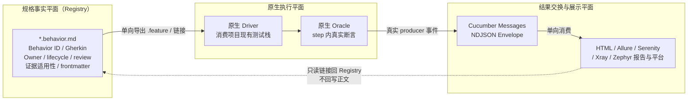

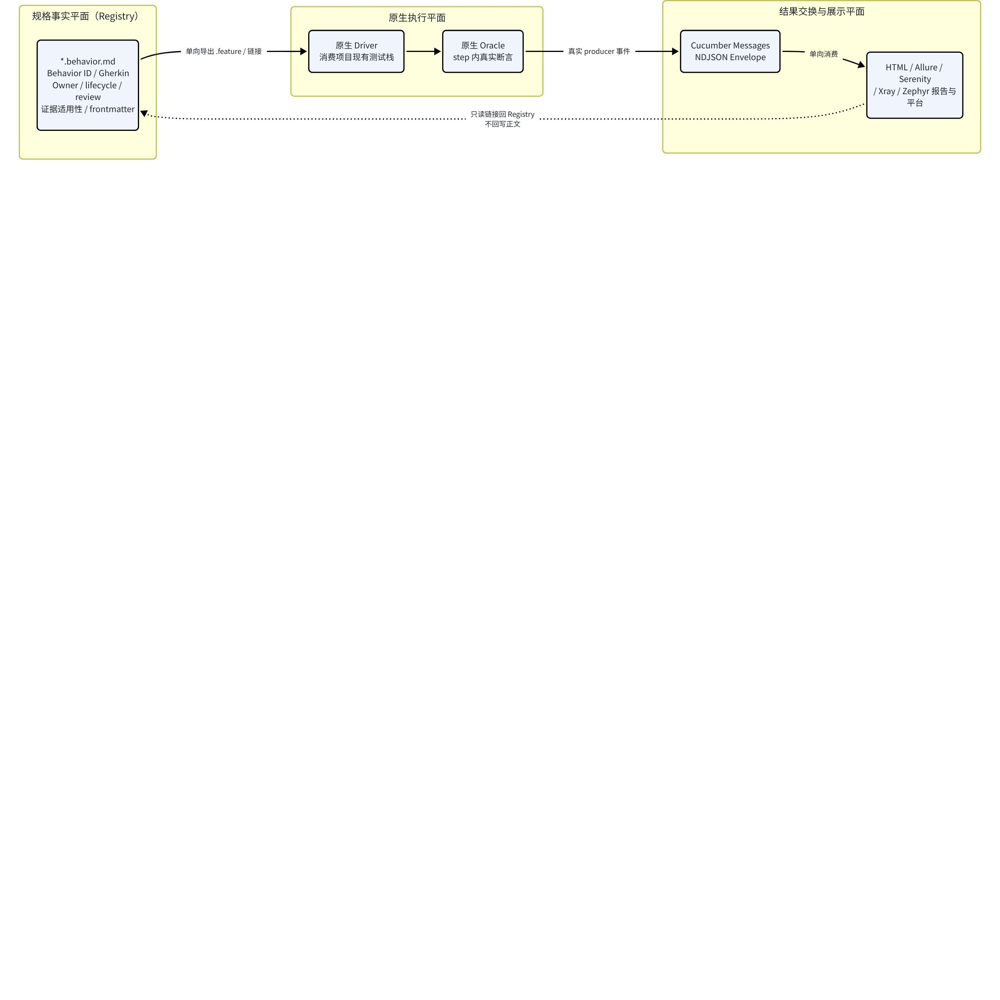

| 平面 | 拥有什么 | 不拥有什么 |
|-|-|-|
| **Registry（规格平面）** | Behavior ID、Gherkin 正文、Owner、lifecycle、review_log、证据适用性、frontmatter、来源 commit。 | 不产生执行事件、不冒充测试结果。 |
| **原生执行平面** | 消费项目现有 Driver 与 step 内真实断言（Oracle）。 | 不拥有 Owner/lifecycle/review；passed/failed 只是执行结果。 |
| **结果交换与展示平面** | Messages/旧 JSON/JUnit XML 等结果协议；HTML、Allure、Serenity、Xray/Zephyr 报告。 | Messages 等不原生建模 Owner/review/lifecycle/证据适用性。 |

**单向边界（三个平面各自）：**

- **Registry：**唯一行为正文 owner；生成物（.feature/JSON/HTML/报告）均可丢弃、不可手改、不反向同步。
- **原生执行平面：**本方案不把消费项目迁移到第二套 Runner。
- **结果交换与展示平面：**只单向接收真实 producer 事件并链接回 Registry；不回写正文，不反向拥有治理字段。

> 
要点：Messages 标准不原生建模 Registry 治理字段，但这**不等于**技术上绝对不能扩展或连接治理数据；正确表述是它不原生承载这些字段，本方案通过 Behavior ID + 版本 + 永久链接单向关联，不让报告工具反向拥有治理数据。平台支持编辑/导入导出正文，与本方案禁止反向正文同步并不矛盾——单向是本方案主动选择，而非厂商不支持。
>

#### 核心概念与一个端到端读者案例

先约定本报告反复使用的核心概念：

- **Behavior ID**：一条可观察规则的唯一标识（如 `tooling.registry.self-check`），用于跨工具与平台追踪。
- **Gherkin AST / Pickle**：官方 parser 把 `.feature` 解析为 AST（适合报告），再编译为 Pickle（适合执行）；Scenario Outline 的每个 Examples 行各产生一个 Pickle。
- **Driver / Oracle**：Driver 是执行入口（消费项目原生测试命令）；Oracle 是判断 Then 是否成立的真实断言。
- **Envelope / NDJSON**：Cucumber Messages 以 JSON Schema 定义、NDJSON 编码的消息流；每行一个 Envelope。
- **scenario / step / result**：Messages 能表达源文件、AST、Pickle、test case、step result、hook result、attachment。
- **来源 commit / review / 生命周期 / 证据适用性**：证据记录被验证版本与真实结果；历史 passed 对应其他代码时须提示；approved 文本不自动证明授权有效。

**端到端读者案例（说明 passed ≠ active ≠ released）：**

1. **Owner 创建行为**：Owner 在 `*.behavior.md` 写好 Gherkin、声明 implementation、driver、oracle；Owner 未确认前保持 `owner: TODO`、`status: pending_decision`。
2. **开发者用原生栈取证**：开发者修改 implementation，运行声明的 driver（如 `mvn test` / `dotnet test` / `pytest`），step 内 Oracle 给出 passed。**此时该 scenario 在该 commit 上 passed。**
3. **结果单向进 Registry**：若该 driver 用 message formatter 产出 NDJSON，Registry 只读该真实 Messages，记录 run_id 与被验证版本；若无场景/step 粒度证据，只链接原始报告并标注关联粒度。
4. **状态分层显示**：视图分别显示——生命周期（lifecycle）、Owner 审查（review_log）、最近验证结果（evidence.result/run_id）、缺失条件、证据是否适用当前版本、是否已发布。
5. **关键区分**：scenario **passed**（该次执行通过）≠ 行为 **active**（Owner 审查 + 完整证据 + 版本适用等晋级条件全部满足）≠ **released**（消费项目发布系统事实）。包级退出码为 0 不能自动把包内每条 Behavior 标成 passed；历史 passed 对应其他代码版本时须提示证据过期。

#### 产品总览矩阵

因维度较多，横向矩阵拆为两表：表 A 覆盖上游/执行产品的规格事实源与原生执行能力；表 B 覆盖协议/下游的证据粒度、Messages 条件、外传与单向边界。**不省略维度。**

##### 表 A：规格事实源与原生执行

| 产品 | 规格语法/事实源 | 原生 Driver | 原生 Oracle | 真实证据最细粒度及前提 |
|-|-|-|-|-|
| @cucumber/gherkin | `.feature`；JS 提供 Classic 与 Markdown token matcher；输出 AST+Pickle | 无（仅解析） | 无断言 | AST 节点/Pickle Step（含 line/column）；前提为合法 .feature |
| Gauge | `.spec`/`.md` Markdown-like，自有语法；`.cpt` concept | daemon + language runner | 步骤代码内断言 | 场景+步骤；前提已 init 并写 step impl |
| Pickles | Gherkin feature + 补充 Markdown（不执行） | 无（只读已有结果） | 无 | 取决于所接 runner 结果文件；本身不产执行事件 |
| Cucumber JVM/Ruby/JS | `.feature`，经 gherkin 编译为 Pickle | 各语言 runtime | step 定义内断言 | Pickle/TestCase+step+hook+attachment；前提开 message formatter |
| Reqnroll v3 | Gherkin `.feature`；MsTest/NUnit/TUnit/xUnit | dotnet test + Reqnroll runtime | step 绑定内断言 | feature/scenario/step；v3 内建 Message formatter |
| Behave | `.feature`（Gherkin 扩展，允许小写关键字） | behave CLI | step 函数内 assert | scenario+step；自有 JSON/JUnit reporter |
| pytest-bdd | `.feature`，官方自述 Gherkin 子集；7.x 起用 gherkin-official parser，9.x 扩展兼容性 | pytest + fixture | step 函数内断言 | outline 展开后用例+step；--cucumberjson 旧 JSON |
| JBehave | `.story` 自有 textual 语法（非 Gherkin） | Embedder/JUnitStory | story 步骤对应 Java 断言 | story+scenario；StoryReporter TXT/HTML/XML |
| Serenity BDD | 不自定语法；requirements 由目录/package/(5.3.1+)注解推导 | 非独立 runner，经 JUnit5 suite 驱动 Cucumber/JBehave/JUnit | 委托底层断言，Serenity 汇总 | requirement+scenario；状态来自执行 |

##### 表 B：协议/下游的证据粒度、Messages 条件与边界

| 产品/协议 | Cucumber Messages 条件 | Registry 字段覆盖 | 外传/凭据/保留 | 单向边界/取舍 |
|-|-|-|-|-|
| Cucumber Messages | 首选协议；emitter 版本下限 JVM≥6/Ruby≥4/JS≥7/ReqnRoll≥3 | 不承载 Owner/review/lifecycle/证据适用性 | 本地 NDJSON 无外传 | 仅做适配，只接真实 producer/保真 adapter |
| 旧 Cucumber JSON | maintenance mode，无正式 Schema | 更弱：缺 AST/源码/step def/parameter types | 本地文件；上传走平台边界 | 不作内部协议，仅厂商 API 强制时边缘兼容 |
| JUnit XML | 无官方 Schema，仅名称+状态 | 无法对应 Behavior 版本/场景/step | 本地文件 | 不作交换协议，仅留作原始证据链接 |
| Cucumber HTML Formatter | 消费 Messages；内建于 JVM/Ruby/JS/Reqnroll | 不理解 frontmatter/lifecycle | 本地静态 HTML，含 feature 全文与 step 片段 | 直接复用但前提是已有真实 Messages；仅作执行报告视图 |
| Cucumber Reports（托管） | 输入 Messages，--publish 上传 | 只理解 Cucumber 报告 | 匿名公开 URL、无登录无凭据；美国数据中心；官方称最短 24h 自动删除（非精确截止） | 暂不接入；不向匿名公开托管外传治理信息 |
| Allure 2 / 3 | 不产 Messages；自有 allure-results 目录 | epic/feature/story 仅是导航 label | 本地静态报告，无内建外传 | 仅做适配；映射 Behavior ID 与版本并链接，不回写 |
| Serenity Living Doc | 自身不直接产 Messages，消费底层 Cucumber 结果 | requirements hierarchy 不含本方案治理字段 | 本地/CI 静态站点 | 仅做适配；读已有报告链接，不迁移执行栈 |
| Reqnroll HTML | v3.0+ 内建 HTML+Message formatter | pending/pass/fail 是执行结果非 lifecycle | 本地静态 HTML/NDJSON，含 feature 全文 | 仅做适配；接受其 Messages，不作通用页面生成器 |
| Xray Cloud/DC | 消费旧 Cucumber JSON；原生支持 feature 双向导入导出 | Xray 字段不含 lifecycle/review/证据适用性 | Cloud 按组织 Cloud API key 配置；DC 用 Basic 认证（PAT 需来源条件）；正文出企业网 | 仅做适配且本方案主动单向；平台原生双向存在但不启用 |
| Zephyr（原 Zephyr Scale） | 消费旧 Cucumber JSON；@TestCaseKey 映射 | 平台 test case 与 Registry 都可编辑 Gherkin | API token 入 CI；用例正文出企业网 | 仅做适配且本方案主动单向；不让其成为第二规格真源 |

#### 上游及执行产品用法

每项按"定位／输入→操作→输出／原生能力与前提／本方案取舍"展开。示例命令均标注**本轮未执行**，涉及插件与版本处说明条件。

##### @cucumber/gherkin

**定位：**Gherkin 官方 parser/compiler，多语言实现，设计上与执行器解耦；AST 适合报告，Pickle 适合执行 [A04]。

**输入→操作→输出：**输入 `.feature` 文本 → parser（Berp 生成）产 AST，compiler 把 AST 编译为 Pickle（每 Scenario 一个 Pickle，Outline 每 Examples 行一个）→ 输出 Envelope 流（source/gherkin-document/pickle），含 1-indexed line/column。

```bash
import { Parser, GherkinClassicTokenMatcher } from '@cucumber/gherkin'
// parser.parse(text) -> compile(gherkinDocument, uri, uuidFn) -> Pickle
npx gherkin features/foo.feature   # 输出 NDJSON 到 stdout
```

**原生能力与前提：**不执行、不断言；JS 同时提供 `GherkinClassicTokenMatcher` 与 `GherkinInMarkdownTokenMatcher`。**取舍：直接复用**，继续以官方 parser 为 Gherkin 语法真源，不自建方言；frontmatter 与 Behavior 边界仍由本工具解析。

##### Gauge

**定位：**ThoughtWorks 发起的轻量跨平台验收测试工具。仓库 README "Important note" 原文要点：官方赞助 2021 年结束，核心团队仅业余看 issue，PR 审阅合并显著延迟，"consider using Gauge only if you're prepared to adopt and support it fully on your own"，已转 community-driven [A01]。

**输入→操作→输出：**输入 `specs/*.spec`（Markdown-like：`#` 规格标题、`##` 场景、`*` 步骤、`Tags:` 行、内联表、`.cpt` concept）+ `steps/*.{java,js,...}` → `gauge specs/`（未执行）→ 输出 Gauge 自有 HTML/JSON 报告 [A02]。

**原生能力与前提：**daemon + language runner；与 Gherkin Given/When/Then 体系不同。**是否产 Cucumber Messages 本轮未证实，且 Gauge 不在 cucumber/messages 官方 emitter 列表 [A05]，状态：不明，不假定。取舍：暂不接入**——扩展名相似但语法、step binding、执行、插件模型都不同，接入等于第二套规格+Runner 且需自担维护。

##### Pickles

**定位：**开源 living documentation 生成器，吃 Gherkin feature + 补充 Markdown，输出 HTML/DHTML/JSON/Word/Excel。README "Pickles End of life"：因 Tricentis 把 SpecFlow EOL，Pickles 完全围绕 SpecFlow 构建，"is going to remain as it is"，官方推荐转 ReqnRoll [A03]。

**输入→操作→输出：**输入 `.feature` + Markdown → 不执行测试，只消费已有 runner 结果（NUnit/xUnit/MSTest/Cucumber JSON/SpecRun）→ 输出文档站/文档文件。

**原生能力与前提：**无 Driver、无 Oracle；结果侧只认旧 Cucumber JSON 等 runner 格式。**取舍：暂不接入**——为已 EOL 展示器加依赖不划算；导出 `.feature` 只能是派生产物。

##### Cucumber JVM / Ruby / JavaScript

**定位：**官方 BDD 执行器族；用 `message` formatter 产 Cucumber Messages。emitter 版本门槛 [A05]：Cucumber-JVM 6.0.0+、Ruby 4.0.0+、JS 7.0.0+。

```bash
# JVM
mvn test -Dcucumber.plugin=message:target/cucumber-messages.ndjson
# Ruby
cucumber --format message --out cucumber.ndjson
# JS
npx cucumber-js --format message:./cucumber.ndjson
```

**原生能力与前提：**Messages 可表达 Gherkin 源、AST、Pickle、TestCase、step result、hook result、attachment、step-definition location、parameter types——比旧 JSON 多这些；旧 `json` formatter 为 maintenance mode，`junit` XML 无官方 schema。**取舍：仅做适配**——已有 Cucumber 项目原命令继续当 Driver，step 断言继续当 Oracle；Registry 只读真实 Messages，不生成 step def，不迁移非 Cucumber 项目。

##### Reqnroll v3

**定位：**开源 .NET BDD（SpecFlow 开源 fork），跑在 Windows/Linux/macOS，支持 .NET Framework 4.6.2+ 与 .NET 8.0；底层执行可用 MsTest/NUnit/TUnit/xUnit，其中 **TUnit 为 v3 新增**（需 `Reqnroll.TUnit` 包）[A06][A08]。

**输入→操作→输出：**输入现有 `.feature` + step 绑定 → 在 `reqnroll.json` 配置 formatters 后 `dotnet test`（未执行）→ 输出独立 HTML（`reqnroll_report.html`，复用 Cucumber React Components/HTML Formatter）与 Messages（`reqnroll_report.ndjson`/`.jsonl`）[A07]。

```json
{
  "formatters": {
    "html":    { "outputFilePath": "report/reqnroll_report.html" },
    "message": { "outputFilePath": "report/cucumber_messages.ndjson" }
  }
}
```

**原生能力与前提：**v3.0（2025-08-21）引入 formatter 基础设施，Message formatter 直接产标准 Cucumber Messages，且被 cucumber/messages 官方 emitter 列表收录（ReqnRoll 3.0.0+）[A05]；官方提示 formatter 接口可能在 minor 版本变化。**取舍：仅做适配**——接受其真实 Messages，不把 Reqnroll 变成 Node 核心依赖；其 pending/pass/fail 不能当 lifecycle。

##### Behave

**定位：**Python BDD，读 `.feature`（Gherkin 扩展，允许小写步骤关键字）+ Python step + 可选 `environment.py`；目录约定 `features/`、`features/steps/` [A09]。

```bash
behave --format json --outfile report.json
# 多 formatter 时注意只一个写 stdout
behave -f pretty -f junit --outfile,- --outfile report.junit.xml
```

**原生能力与前提：**formatter 列表：json/json.pretty/plain/pretty/progress 等；reporter：junit/summary；第三方 `allure-behave` [A10]。**关于 Messages 的保守口径：**经核对 Behave 官方 formatter/reporter 列表，其中未列出 Cucumber Messages/NDJSON；JSON 为自有格式，JUnit 为 reporter。此结论**限定于对官方 formatter 列表的核对**，要接 Messages 需写自定义 Formatter（`behave -f module:Class`）或用 Allure 适配，属"需适配"，不推论为"Python 生态一律无 Messages"。**取舍：仅做适配**——把命令与真实断言登记为 Driver/Oracle；Behave JSON 不是统一协议，优先链接原报告。

##### pytest-bdd（重点修正对象）

**定位：**pytest 的 BDD 库，官方自述 "implements a subset of the Gherkin language"，复用 pytest runner 与 fixture；当前文档版本 9.0.0 [A11]。

**语法范围（版本修正）：**官方 stable changelog 写明 "Since the 7.x series: Use the gherkin-official parser, replacing the custom parsing logic"，即 **7.x 起改用官方 gherkin-official parser 替换自研解析**；9.x 在此基础上扩展依赖与语法兼容性（放宽 `gherkin-official` 版本约束、修复空 description 解析），并支持 Rule（标签下渗）、Background（仅限 Given）、多 Example 表+按标签过滤、堆叠多行标签、`*` 通配关键字、datatable/docstring 参数、`# language:` 本地化；仍有 `Feature:` 必填、标签不能含空格等约束。**关键判断：使用官方 parser 不等于具备官方全语法执行契约——具体支持到哪些 Gherkin 结构、与官方 parser 版本的兼容范围需逐版验证**，官方仍自述 subset，且"子集"不能反向限制 Registry 采用官方全量 Gherkin。

```bash
pytest --cucumberjson=report/cucumber.json   # 展开后的旧 Cucumber JSON
pytest -v --gherkin-terminal-reporter
```

**关于 Messages 的保守口径：**9.x 文档 Reporting 节只给出 `--cucumberjson`（展开后旧 Cucumber JSON）与 terminal reporter，**经核对该节未见原生 Messages/NDJSON formatter**；但暴露 `pytest_bdd_before_scenario/after_step/step_error` 等 hooks，可据此自建 adapter——属"需适配"，不推论为"Python 生态一律无 Messages"。**取舍：仅做适配**——仍以 pytest 为原生 Driver，不把 pytest-bdd 定义为 Registry 标准运行时。

##### JBehave

**定位：**JVM BDD，textual `.story` 语法 + Embedder 执行；可作 JUnit 测试跑，也支持 TestNG/Spring Test [A12]。

**输入→操作→输出：**输入 `src/test/resources/stories/*.story` + Java step 类 → `mvn verify`（经 JBehave Maven goals，未执行）→ 输出 `target/jbehave/view/reports.html` + TXT/XML。StoryReporter 体系：Console/Txt/Html/HtmlTemplate(Freemarker)/XmlOutput + statistics [A13]。

**原生能力与前提：**不原生产 Messages（自有 StoryReporter，不在 emitter 列表 [A05]）。**取舍：仅做适配**——已有 JBehave 项目只链接执行证据，不做规格双向转换。

##### Serenity BDD

**定位：**JVM 报告/living documentation 库，目标是"活文档"；Requirements 标签页展示 [A14]。

**输入→操作→输出：**不定义自有规格语法；requirements 层级由目录结构（Cucumber/JBehave）或 package（JUnit）或注解（5.3.1+ `@Epic/@Feature/@Story`）推导，各级放 `readme.md`。经 JUnit 5 suite（`@Suite @IncludeEngines("cucumber")`）驱动 Cucumber；`mvn clean verify`（未执行）→ 输出 Serenity HTML 报告。

**原生能力与前提：**本身不是独立 runner，断言来自底层 Cucumber/JBehave/JUnit；Serenity 5.0.0 起 Cucumber plugin 路径改为 `net.serenitybdd.cucumber.core.plugin.*`，并行自 3.6.0 [A15]。**Serenity 自身是否直接转发/产出 Messages 本轮官方材料未见，状态：不明，不假定。取舍：仅做适配**——读已有报告链接，不为展示迁移执行栈或复制其 requirements hierarchy。

#### 协议与下游用法

执行与报告同产品处不重复长篇，交叉引用但保留关键边界。

##### Cucumber Messages

JSON Schema 定义、NDJSON 编码的组件间消息协议，目标解耦 Gherkin、执行器与 formatter，支持流式低内存处理 [B01]。能表达源文件文本、AST、Pickle、test case、step result、hook result、attachment；**前提**是必须由真实 emitter 产出或保真 adapter 转换，不能从退出码/文件级报告编造场景级事件。语言实现覆盖 .NET/Dart/Java/JavaScript/Perl/PHP/Python/Ruby，但 emitter 有版本下限（见表 B）。**取舍：首选场景级结果协议，仅做适配。**

##### 旧 Cucumber JSON 与 JUnit XML

旧 JSON 官方列为 maintenance mode，**无正式 Schema**，跨实现存在细微不一致，缺 Gherkin 原始源码/AST/step definitions/parameter types [B01]。JUnit XML 官方称**无官方 Schema**，只能承载用例名与状态等极有限信息，无法可靠恢复 Gherkin 源、step、hook 或 Behavior ID。**取舍：**旧 JSON 仅在 Xray/Zephyr 等厂商 API 强制要求时做边缘兼容；JUnit XML 仅保留为消费项目原始证据链接，二者均不作新内部协议。

##### Cucumber HTML Formatter

跨平台独立 HTML 报告生成器，基于 `@cucumber/react-components`，消费任意实现的 Messages；已内建于 cucumber-ruby、cucumber-jvm、cucumber-js、Reqnroll [B02]。输入 NDJSON，输出单个静态 HTML。**定制能力（须区分两类）：**据本轮材料，Cucumber HTML Formatter **库**的自定义页面标题/图标、额外 CSS/JS、替换默认 JS/CSS 见之于 Java 与 .NET 实现 [B02]；但这**不等于** Reqnroll v3 当前**内置** HTML formatter 支持定制——后者当前不允许定制或模板化，需定制走 `ICucumberMessageFormatter` 或用 message formatter 接外部工具 [B06]。**取舍：直接复用，但前提是已有真实 Messages；作为执行报告视图，不作为完整 Registry 页面。**

```bash
cucumber-js --format message:build/report.ndjson
cucumber-js --format html:build/report.html
# 不启用 --publish，避免外传至公开托管
```

##### Cucumber Reports（托管）

Cucumber 核心维护者提供的免费托管报告，MIT 开源，由各实现内建 `--publish` 上传（Ruby≥6.1.0 / JVM≥6.10.4 / JS≥7.3.0）[B03]。**凭据/鉴权：**发布是匿名的，无登录、无账号、无 API key；报告一旦发布即位于公开 URL、无鉴权，官方称极难猜测 URL 但应假定可能被猜到 [B04]。**数据保留（官方 Terms 原文）：**数据存美国数据中心、静态加密；官方 Terms 写明报告 "automatically deleted after 24 hours…minimum retention period, not an exact cutoff…may be live for longer…"（即至少 24 小时后自动删除，此为最短保留期而非精确截止，实际可能存活更久），可用 Delete 按钮立即删除；官方警告勿传商业敏感 IP、PII、凭据与 secrets [B04]。**取舍：暂不接入**——先有明确读者与内部数据批准；本方案不向匿名公开托管外传含治理信息的内容。注意：该服务本身**无凭据**，原 Note"凭据"一词应修正为"匿名公开 URL + 数据出境"风险。

##### Allure 2 与 Allure 3（必须区分）

共同数据格式：每个测试运行一个 `{uuid}-result.json`，含 name/status/start/stop/steps/attachments/parameters/links/labels；状态值 failed/broken/passed/skipped/unknown；`epic/feature/story` 仅是**导航 label**，可自定义任意 label [B07]。

- **Allure 2**：Java 系两阶段——framework adapter 写结果到 `allure-results/`，Java CLI 读目录生成 HTML [B07]。
- **Allure 3**：TypeScript 重写、模块化插件系统、Awesome 插件；CLI 为 npm 包（`npx allure`），命令 `run/generate/open/watch/agent`，配置 `allurerc.*`；仍读 `allure-results/` [B08][B14]。

```bash
# Allure 2（Java CLI）
allure generate allure-results -o allure-report && allure open allure-report
# Allure 3（npx）
npx allure generate allure-results && npx allure open allure-report/awesome
```

**取舍：仅做适配。**`epic/feature/story` 不能覆盖 Registry 治理字段，不是跨工具 Behavior lifecycle 协议；已有 Allure 时映射 Behavior ID 与版本并链接报告，不反向回写。

##### Serenity Living Documentation

以 Requirements 标签页呈现活文档，由自动化测试套件生成、随构建保持最新 [B05]。层级=嵌套目录（Cucumber/JBehave）或 package（JUnit）；各层 `readme.md` 写描述，嵌套 readme 首行须为需求名；默认层级 JUnit=capability>feature>story、Cucumber=theme>capability>feature；可 `serenity.requirements.types` 自定义。无实现测试的需求标 pending。**取舍：仅做适配**——已有 Serenity 报告时提供链接，不为展示迁移执行栈或复制其 requirements hierarchy。

##### Reqnroll HTML / Message formatter

见"上游及执行产品用法 · Reqnroll v3"。HTML 默认 `reqnroll_report.html`、Messages 默认 `reqnroll_report.ndjson`，落在项目输出目录（如 `bin/Debug/net8.0/`）[B15]。HTML 当前不支持定制/模板；pending/pass/fail 是执行结果不是 lifecycle。**取舍：仅做适配**，接受其真实 Messages，不作通用页面生成器。

##### Xray Cloud / Data Center

Jira 内 BDD/测试管理，追踪模型关联 Requirement、Test、Test Run、Defect [B09][B10]。**认证/端点：**Cloud 端导入执行结果用 Bearer token 调 `/api/v2/import/execution/cucumber`（v2 导入端点已核实；Bearer token 的获取按组织 Cloud API key 配置，本轮未独立读出 authenticate/Client ID-Secret 页面细节）；Data Center 端已核实用 HTTP Basic 认证，端点 `/rest/raven/1.0/import/execution/cucumber`（PAT 方式需来源条件，本轮未展开）。两端均消费旧 Cucumber JSON，并原生支持 feature 导入（`/import/feature`）与导出（`/export/cucumber`）。

```bash
# Xray Cloud：Bearer token 按组织 Cloud API key 配置获取后，推旧 Cucumber JSON
# curl -H "Authorization: Bearer $TOKEN" -H "Content-Type: application/json" \
#   -X POST --data @target/cucumber/report.json \
#   https://xray.cloud.getxray.app/api/v2/import/execution/cucumber
```

**取舍：仅做适配，且由本方案主动限制为单向。**Xray 本身即支持 feature 双向导入导出与结果回传，这是厂商产品能力；让 Xray 编辑并回导 scenario 会与 `*.behavior.md` 争夺正文 owner，故本方案只单向同步 Behavior ID、链接与真实结果。**限制来自本方案守单一事实源，非 Xray 不支持。**

##### Zephyr（原 Zephyr Scale）Cloud

**产品更名（关键修正）：**据 SmartBear Zephyr DC v11 release notes，2025-04-02 v11 起产品写作 "Zephyr（原 Zephyr Scale）" [B12][B13]；该更名日期来自 DC release notes，不推广为 Cloud 统一更名日期。Cloud Cucumber 集成页标题仍为 "Zephyr Scale Cloud"（文档未全面改名）[B11]。

**工作流：**官方图示为闭环双向——从 Jira 导出 BDD 用例 → CI 执行 → 回传结果；scenario 加 `@TestCaseKey=ABC-T123` 标签映射 test case，用旧 Cucumber JSON 输出（`json:target/cucumber/calculator.json`）后经 CI post-build task 或 API 上传；无对应自定义状态时显示 Blocked [B11]。

**取舍：仅做适配，本方案主动单向。**平台本身支持在 Zephyr 写 Gherkin、导出、回传结果，双向是厂商产品能力；本方案不让 Zephyr 成为第二规格真源，只做单向链接/结果 adapter。**非厂商不支持双向。**

#### 产品截图解读

> 
本节嵌入六个产品、共十张官方公开演示/官方文档产品 UI 截图（采集日期 2026-10-16，只读采集，未登录账号、未发布）。每张注明来源 URL、界面版本或未标示、2–3 个观察点、以及"不能证明什么"。**所有图均为官方示例/演示数据，其 PASSED/FAILED 只反映官方示例，不代表本项目实际执行或本项目用例通过。为便于对照用法，Xray 与 Zephyr 两处先展示主用法图（图9 Test Run Gherkin step 结果、图10 已填 BDD-Gherkin 编辑器），其补充图（图7 Coverage 面板、图8 空白新建用例编辑器）紧随其后；编号顺序按产品分组，不代表重要性。**
>

##### Cucumber HTML Formatter（官方仓库 Playwright 截图 fixture）

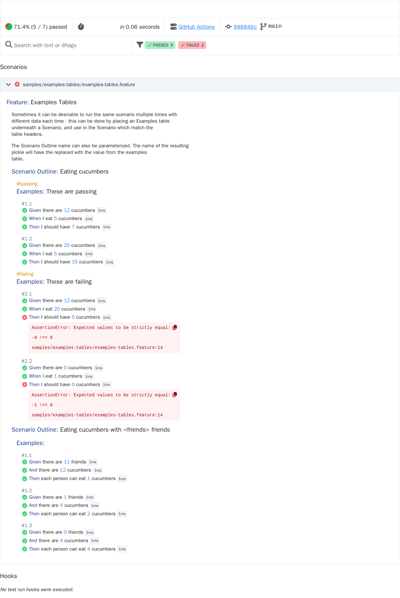

**观察点：**顶栏 "71.4% (5/7) passed" 与计时、GitHub Actions 链接；搜索框支持 "text or @tags"，PASSED 5 / FAILED 2 状态筛选；Scenario Outline "Eating cucumbers" 带 @passing/@ailing 标签，Examples 行 #1.1–#2.2 与红色 AssertionError 块。**不能证明：**这是 formatter 的 Playwright 提交截图 fixture，非某次真实用户运行；不指明由 JVM/JS/Ruby 哪个实现产出；0.06s 为 fixture 示意时长。

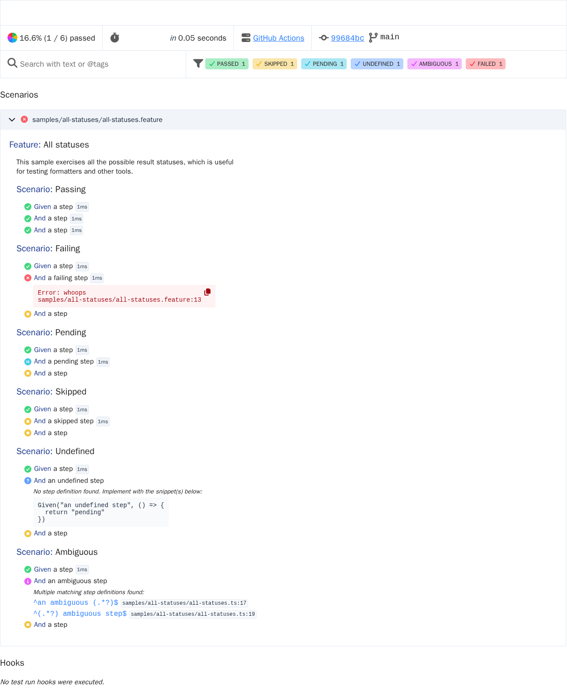

**观察点：**顶栏 "16.6% (1/6) passed"，PASSED/SKIPPED/PENDING/UNDEFINED/AMBIGUOUS/FAILED 六色状态；Feature "All statuses" 六个 scenario 各带 step 级状态图标与每步毫秒徽标；失败步骤内联堆栈块、未定义/歧义步骤给出代码片段建议，页脚 Hooks 区。**不能证明：**这是覆盖全部状态的合成 fixture，非真实项目运行；页脚显示无 hooks 执行；与任何消费项目或 Behavior 无关。

*来源：*[*cucumber/html-formatter 仓库截图 fixture 目录*](https://github.com/cucumber/html-formatter/tree/main/javascript/test/__screenshots__)*。*

##### Reqnroll v3 HTML Formatter（官方博客示例）

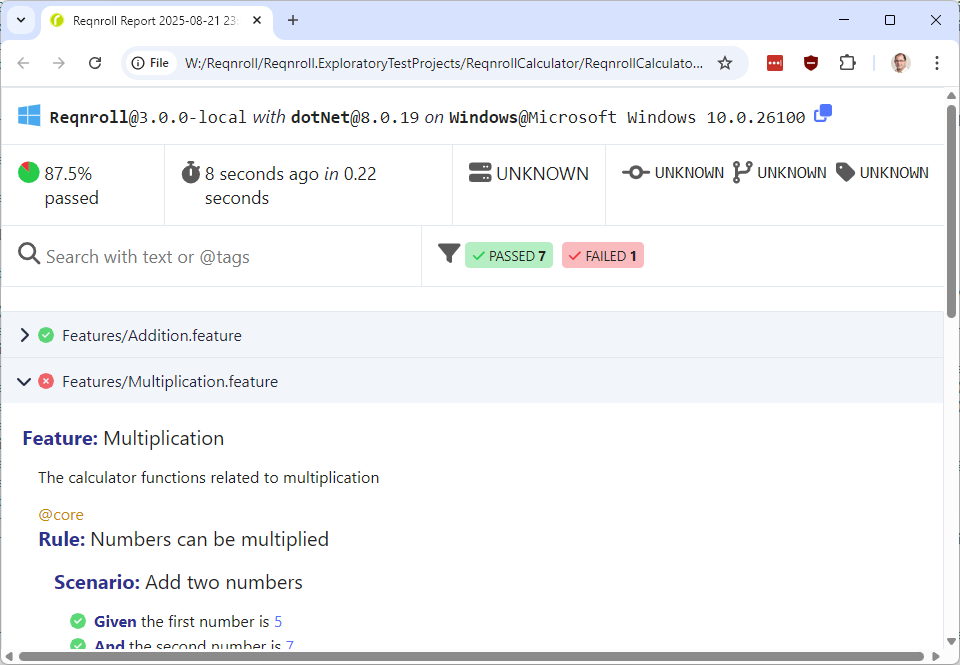

**观察点：**头部 "Reqnroll@3.0.0-local with dotNet@8.0.19" 与 87.5% passed / 0.22 秒统计条；Feature 文件树 Addition.feature（绿）/ Multiplication.feature（红），PASSED 7 / FAILED 1；Feature: Multiplication 带 @core 标签、Rule: Numbers can be multiplied、Given/And 步骤绿色对勾。**不能证明：**这是官方 Calculator 示例项目截图，非本项目输出；CI/branch/commit 字段在示例中未填充。

*来源：*[*Reqnroll v3.0 released with new reporting（官方博客）*](https://reqnroll.net/news/2025/08/reqnroll-v3-0-released-with-reporting/)*。*

##### Allure Report（公开演示站，窄屏视口）

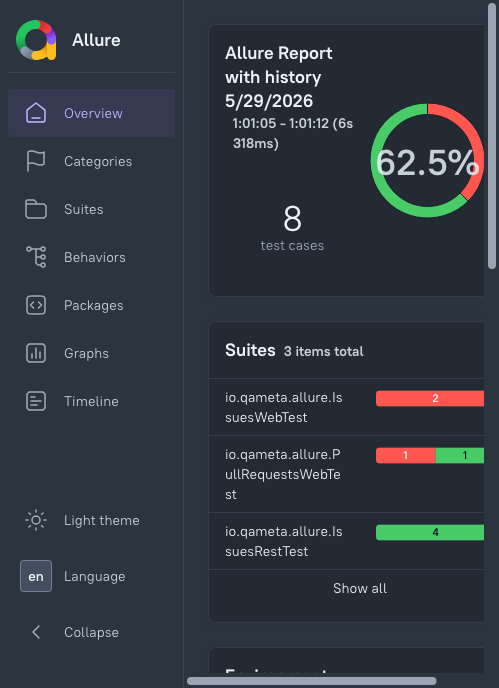

**观察点：**左侧 Overview/Categories/Suites/Behaviors/Packages/Graphs/Timeline 导航；头部 "Allure Report with history 5/29/2026" 与 62.5% 环形进度；Suites 面板列出 io.qameta.allure 测试类红绿状态条。**不能证明：**演示数据是否对应真实生产测试套件；确切 Allure 报告版本与所用 adapter；下方 environment/history 是否有内容。

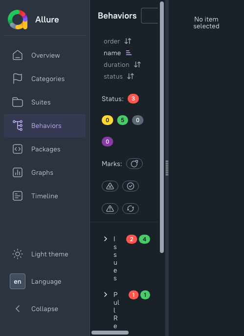

**观察点：**Behaviors 标签激活，搜索框与排序/状态控件；状态筛选胶囊 3 failed / 0 skipped / 5 passed / 0 broken；Issues(2,4) 与 Pull Requests(1) 标签行，epics 树部分展开。**不能证明：**右侧 "No item selected"，无 step 级行为详情；epic/feature/story 标签是否映射本项目 Behavior Registry 未知。

*来源：*[*Allure 官方公开演示站*](https://allure-framework.github.io/allure-demo/15/index.html)*。窄屏视口，已限制显示宽度。*

##### Serenity BDD Living Documentation（官方教程示例）

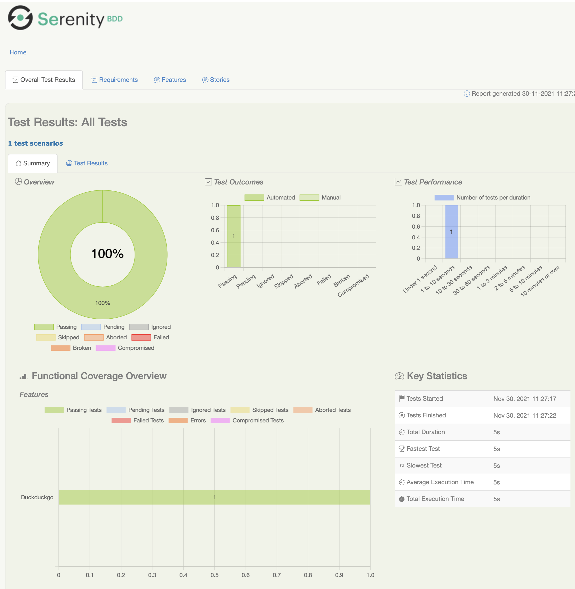

**观察点：**顶部 Overall Test Results / Requirements / Features / Stories 标签；中央 100% 环形图与 Test Outcomes、Test Performance 时长条形图；Functional Coverage Overview（Features 轴 DuckDuckgo）与 Key Statistics（Total Duration 5s）。**不能证明：**这是教程单场景示例，非多 feature 项目；渲染所用 Serenity core 版本未标示；一个 feature 以下的 requirements 层级是否填充未知。

*来源：*[*Serenity BDD 官方教程*](https://serenity-bdd.github.io/docs/tutorials/first_test)*。*

##### Xray Cloud（官方文档：Test Run 与 Gherkin step 级结果）

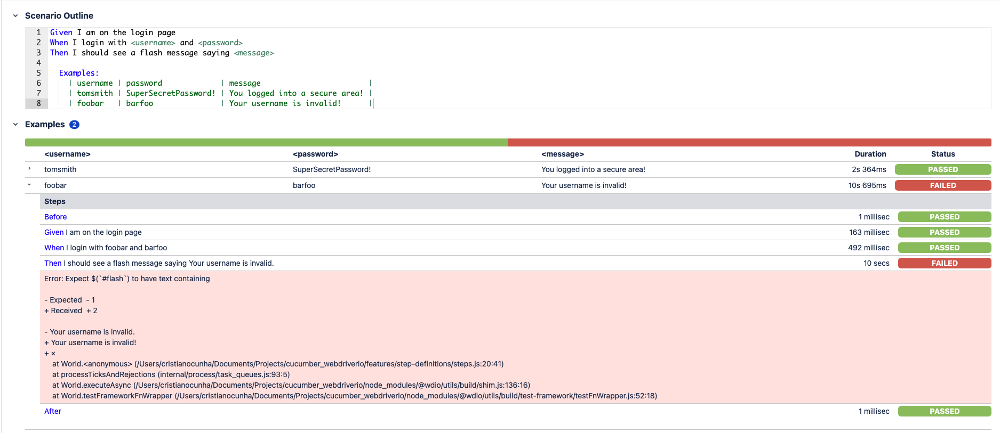

**观察点：**上方面板展示 Scenario Outline Gherkin 源（Given/When/Then 带 <username>/<password>/<message> 占位符与 Examples 表）；下方 Examples 结果行列出每行 Duration/Status（示例中 row1 tomsmith 标 PASSED、row2 foobar 标 FAILED）；展开 Steps 段列出 Before/Given/When/Then 各步时长与 PASSED/FAILED 胶囊，含红色 expected-vs-received 错误块与 After hook。**不能证明：**这是文档教程的 login 示例，其 PASSED/FAILED 不代表本项目 Behavior ID 或本项目用例通过；不证明渲染所用 Xray/Jira 平台版本；失败 Then 是否对应真实 Oracle 期望未知。

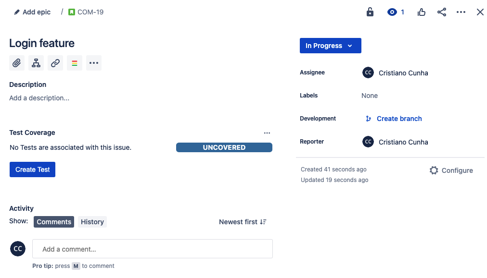

**观察点：**Jira issue 视图标题 "Login feature"，状态 In Progress；Test Coverage 面板显示 "No Tests are associated with this issue"、蓝色 UNCOVERED 徽标与 "Create Test" 按钮。**不能证明：**该需求当前零覆盖，不展示通过/失败的 step 执行结果；不证明该 feature 映射本项目 \*.behavior.md。

*来源：*[*Xray Cloud 官方文档*](https://docs.getxray.app/display/XRAYCLOUD/Testing using WebDriverIO and Cucumber in JavaScript)*（页面 2024-03-19 更新）。*

##### Zephyr（官方文档：已填写 BDD-Gherkin Test Script 编辑器）

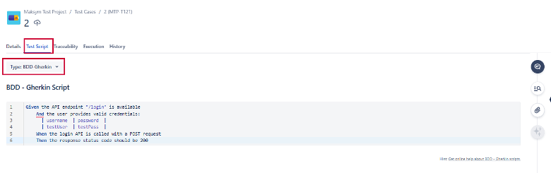

**观察点：**Jira issue 头部 "Malakyn Test Project / Test Cases / MTP-T121"，Test Script 标签激活；"Type: BDD - Gherkin" 下拉选中；已填写的 Gherkin 编辑器含 Given/And/When/Then（一个 /login API 测试），含 Examples 表 |username|password| 与 |testuser|testpass| 行。**不能证明：**这是**编写编辑器**，不是执行结果或通过/失败状态；是否配置 @TestCaseKey 标签或自动化接线未知；背后租户/版本未标示。

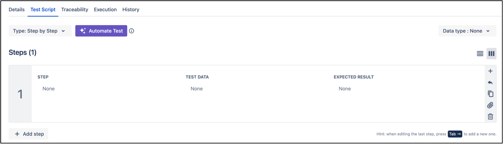

**观察点：**Details / Test Script / Traceability 等标签条；Type: Step by Step 下拉与紫色 "Automate Test" 按钮；Steps(1) 表 STEP/TEST DATA/EXPECTED RESULT 均为 None。**不能证明：**这是新建用例的空白编辑器，非已填 BDD/Gherkin 或执行结果；不证明后续已自动化。

*来源：*[*SmartBear Zephyr 官方文档（BDD-Gherkin）*](https://support.smartbear.com/zephyr/docs/en/test-cases/gherkin-behavior-driven-development--bdd-.html)*；补充图来自* [*创建测试用例页*](https://support.smartbear.com/zephyr-scale-cloud/docs/test-cases/creating-a-test-case.html)*。*

#### Note 核验与修正表

区分"事实不准确""版本限定"与"本方案政策"三类。未发现需要推翻的方向性结论；以下均为事实补全与名称/边界修正。

| 原主张（Note） | 本轮证据 | 建议表述 | 类型 |
|-|-|-|-|
| pytest-bdd "实现 Gherkin 子集，复用 pytest runner/fixture" | changelog "Since the 7.x series: Use the gherkin-official parser…"；9.x 扩展依赖与 Rule/多 Examples 兼容 [A11] | "7.x 起改用官方 Gherkin parser，9.x 扩展兼容性，仍自述 subset"；强调官方 parser≠全语法执行契约，具体范围需逐版验证 | 版本修正 |
| Python 框架 Messages 能力 | Behave 官方 formatter/reporter 列表无 Messages [A10]；pytest-bdd 9.x Reporting 节未见 Messages [A11] | 限定为"经核对官方 formatter/Reporting 列表未列 Messages"，不推论 Python 一律无 Messages；要接需自定义 adapter | 事实修正（保守化） |
| Reqnroll "内建 HTML 与 Messages formatter" | 仅 v3.0+；HTML 当前不支持定制；默认产物 reqnroll_report.html/.ndjson [B06][B15] | 补"仅 v3.0+""HTML 不支持定制模板" | 版本限定 |
| Messages emitter 版本门槛 | JVM≥6.0.0/Ruby≥4.0.0/JS≥7.0.0/ReqnRoll≥3.0.0 [A05] | 补精确版本号；旧 json 为 maintenance mode | 版本限定 |
| HTML Formatter 已内建于 JVM/Ruby/JS/Reqnroll | 库定制（标题/图标/CSS/JS）据材料见之于 Java 与 .NET [B02]；Reqnroll v3 内置 HTML formatter 不支持定制 [B06] | 明确区分"库的 Java/.NET 定制"与"Reqnroll 内置 formatter 不可定制"，二者不等同 | 版本限定 |
| Cucumber Reports "上传引入外部数据、凭据、网络和保留边界" | 该服务匿名发布、无登录无凭据；公开 URL 无鉴权、美国数据中心；Terms 原文最短 24h 删除、非精确截止 [B04] | 修正"凭据"为"匿名公开 URL+数据出境"；保留 Terms 原文措辞 | 事实修正 |
| Allure "从 result files 构建 HTML" | 必须区分 Allure 2（Java CLI）与 Allure 3（TypeScript/npx/插件/Awesome）[B07][B08][B14] | 补 2/3 差异：CLI 与配置完全不同，均读 allure-results/ | 事实补全 |
| Xray "支持 Jira/Xray 与 Git 导入导出 feature" | Cloud Bearer+v2 导入端点已证、authenticate 细节未独立读；DC Basic 已证、PAT 需来源条件；平台原生双向 [B09][B10] | 补 Cloud/DC 认证差异与"按组织 Cloud API key 配置"；本方案单向是主动限制，非厂商不支持 | 事实补全+本方案政策 |
| "Zephyr Scale Cloud" 用 .feature/@TestCaseKey | 据 DC v11 release notes，2025-04-02 起写作 Zephyr（原 Zephyr Scale）[B12][B13] | 名称改为"Zephyr（原 Zephyr Scale）"；@TestCaseKey 机制不变；更名日期来自 DC notes，不推广 Cloud 统一日期 | 事实修正（更名） |
| Gauge 赞助结束 / Pickles EOL | Gauge 2021 赞助结束转社区自维护 [A01]；Pickles 因 SpecFlow EOL 而保持现状 [A03] | 原说法属实，保留时间/维护条件 | 事实核实属实 |

#### 分阶段实施与退出条件

按"先不变栈，后接真实 producer"推进，**不先建通用 adapter**，不给工期估计。版本化静态视图只是未来方案文字，本轮不生成 HTML。

1. **阶段 0：Registry 与原生栈不变。**Registry 继续描述行为，消费项目继续用原生 Driver/Oracle；本阶段不迁移任何测试框架。**退出条件：**一条现有测试已证明的行为能从 Behavior ID 走到实现、Oracle 与来源 commit。
2. **阶段 1：版本化静态视图（仅文字方案）。**未来由 CI 从固定 commit 生成只读静态视图，分别显示 lifecycle/review/历史结果/证据适用性/缺失条件，标注来源 commit，可重建。**退出条件（未来）：**验证过"passed 但证据过期""blocked""Scenario Outline"三类；生成失败时不沿用旧页面冒充当前版本。本轮不生成 HTML。
3. **阶段 2：真实 producer 后接 Messages。**仅当消费项目已产出真实 Cucumber Messages（满足 emitter 版本下限），Registry 才只读接受 NDJSON；无场景/step 粒度证据时只链接原始报告并标注关联粒度。**退出条件：**能从真实 Messages 还原 scenario/step 结果且可追溯到 Behavior ID 与版本；不接受从退出码/文件级报告编造事件。
4. **阶段 3：已采用平台后单向适配。**仅当组织已选定 Xray/Zephyr 等平台，才在消费项目侧做单向 adapter：只推 Behavior ID、版本、永久链接与真实结果，不回写正文。**退出条件：**正文仍唯一落在 `*.behavior.md`，平台编辑不会回导为第二份行为源。

> 
**安全与验收门槛：**(1) 不向匿名公开托管（Cucumber Reports）外传含治理信息内容，直至有明确读者与内部数据批准；(2) 平台凭据（Xray Cloud API key、Zephyr token）入 CI 密钥，不写入 Registry 正文；(3) 历史 passed 对应其他版本时提示证据过期，无法判断适用性保持未知，不把 lint 成功显示为业务通过；(4) MR reviewer 能从 Behavior ID 回到实现、Oracle、运行记录与授权来源，并始终可看原始 diff；(5) 候选自检与外部复验结果分层显示，任一层失败不被另一层成功覆盖。
>

#### 风险与待核实问题

- **治理数据归属：**Messages/报告工具不原生承载 Owner/review/lifecycle/证据适用性；可单向关联但不能让报告工具反向拥有治理字段。事件粒度、标签字段、附加链接能力不等于独立业务证据或审查授权。
- **外部上传与数据保留：**Cucumber Reports 为匿名公开 URL、数据存美国；Terms 称报告至少 24 小时自动删除（最短保留期，非精确截止，实际可能更久）；未发现付费/长期保留的官方明文，不报更长期限。
- **凭据与账户差异：**Xray Cloud Bearer+v2 导入端点已证，Bearer token 获取按组织 Cloud API key 配置（authenticate/Client ID-Secret 页本轮未独立读出）；DC HTTP Basic 已证，PAT 方式需来源条件；本轮未访问任何真实账号。
- **版本兼容：**pytest-bdd 7.x 换官方 parser、9.x 扩展兼容性的具体边界、Reqnroll v3 formatter 接口可能 minor 变更、Serenity 5.0.0 plugin 路径改名——用法须带版本条件，具体支持范围逐版验证。
- **映射粒度：**包级退出码/文件级报告不能反推 step 通过事件；无场景/step 粒度证据时只链接原始报告并标注关联粒度。
- **未证实支持（状态：不明，不猜）：**Gauge 是否产 Cucumber Messages；Serenity 是否在某版本直接转发/产出 Messages。本轮官方材料未见，标"不明"。

#### 参考来源和截图索引

保留上游包 A01–A15 与下游包 B01–B15 引用编号，逐条可追溯。**本轮不声称原 Note 的 E1–E24 全部已重核**；核对范围为本报告所列产品与协议。

##### 上游/执行来源（A01–A15）

| 编号 | 标题 | URL |
|-|-|-|
| A01 | getgauge/gauge README（赞助 2021 结束、社区自维护） | https://github.com/getgauge/gauge |
| A02 | Gauge Docs — Write Gauge specifications | https://docs.gauge.org/writing-specifications.html |
| A03 | picklesdoc/pickles README（EOL、输入输出、runner 集成） | https://github.com/picklesdoc/pickles |
| A04 | cucumber/gherkin README（AST/Pickle、多语言、NDJSON Envelope） | https://github.com/cucumber/gherkin |
| A05 | cucumber/messages README（emitter 版本门槛、json maintenance、junit 局限） | https://github.com/cucumber/messages |
| A06 | Reqnroll v3.0 released with new reporting（2025-08-21；TUnit） | https://reqnroll.net/news/2025/08/reqnroll-v3-0-released-with-reporting/ |
| A07 | Reqnroll formatters（HTML/Messages、reqnroll.json） | https://docs.reqnroll.net/latest/reporting/reqnroll-formatters.html |
| A08 | Reqnroll Documentation（MsTest/NUnit/TUnit/xUnit） | https://docs.reqnroll.net/latest/ |
| A09 | Behave — Gherkin（目录约定、小写关键字） | https://behave.readthedocs.io/en/stable/gherkin.html |
| A10 | Behave — Formatters and Reporters | https://behave.readthedocs.io/en/stable/formatters.html |
| A11 | pytest-bdd 文档（7.x 起 gherkin-official、9.x 扩展、hooks） | https://pytest-bdd.readthedocs.io/en/stable/ |
| A12 | JBehave — Running Stories（Version 5.2.0） | https://jbehave.org/reference/stable/running-stories.html |
| A13 | JBehave — Story Reporters（Version 5.2.0） | https://jbehave.org/reference/stable/reporting-stories.html |
| A14 | Serenity BDD — Living Documentation | https://serenity-bdd.github.io/docs/reporting/living_documentation |
| A15 | Serenity BDD — Running Cucumber（plugin 路径改名） | https://serenity-bdd.github.io/docs/guide/cucumber |

##### 协议/下游来源（B01–B15）

| 编号 | 标题 | URL |
|-|-|-|
| B01 | Cucumber Messages README（json maintenance、junit 局限、emitter 下限） | https://github.com/cucumber/messages |
| B02 | Cucumber HTML Formatter README（内建实现、Java/.NET 定制） | https://github.com/cucumber/html-formatter |
| B03 | Cucumber Reports 首页（publish 版本下限） | https://reports.cucumber.io/ |
| B04 | Cucumber Reports Terms & Privacy（匿名、公开 URL、美国、24h 最短删除） | https://reports.cucumber.io/terms |
| B05 | Living Documentation — Serenity BDD User Manual | https://serenity-bdd.github.io/docs/reporting/living_documentation |
| B06 | Reqnroll formatters（v3.0+ HTML/Messages） | https://docs.reqnroll.net/latest/reporting/reqnroll-formatters.html |
| B07 | Allure Report — Test result file | https://allurereport.org/docs/how-it-works-test-result-file/ |
| B08 | Allure 3 README（TypeScript/npx/插件/Awesome） | https://github.com/allure-framework/allure3/blob/main/README.md |
| B09 | Xray Cloud — Import Execution Results REST v2 | https://docs.getxray.app/display/XRAYCLOUD/Import+Execution+Results+-+REST+v2 |
| B10 | Xray 7.5.0 — Testing using Cucumber in Java（DC 端点/Basic） | https://docs.getxray.app/display/XRAY750/Testing+using+Cucumber+in+Java |
| B11 | Zephyr Scale Cloud — Cucumber Integration（@TestCaseKey） | https://support.smartbear.com/zephyr-scale-cloud/docs/test-automation/cucumber-integration.html |
| B12 | Zephyr DC v11 Release Notes（2025-04-02 更名） | https://support.smartbear.com/zephyr-dc/docs/en/zephyr-scale-server-data-center-release-notes/version-11.html |
| B13 | Welcome to the Zephyr Documentation | https://support.smartbear.com/zephyr/docs/en/welcome.html |
| B14 | Allure Report — Visual Analytics（Allure 3 vs 2） | https://allurereport.org/docs/visual-analytics/ |
| B15 | Reqnroll Formatter Configuration（默认输出路径） | https://docs.reqnroll.net/latest/installation/formatter-configuration.html |

##### 截图索引（采集日期 2026-10-16）

| 图号 | 产品 | 版本/界面 | 来源 |
|-|-|-|-|
| 图1/图2 | Cucumber HTML Formatter | 未标示（commit 99684bc/main fixture） | cucumber/html-formatter 仓库截图 fixture |
| 图3 | Reqnroll v3 HTML | Reqnroll 3.0.0-local / .NET 8.0.19 | Reqnroll v3.0 发布博客 |
| 图4/图5 | Allure Report | 未标示（演示站 /15/，5/29/2026） | Allure 官方公开演示站 |
| 图6 | Serenity Living Doc | 未标示（报告生成 30-11-2021） | Serenity 官方教程 |
| 图7/图9 | Xray Cloud | 未标示（文档 2024-03-19 更新；教程示例） | Xray Cloud 官方文档（Coverage 面板 / Test Run Gherkin 结果） |
| 图8/图10 | Zephyr（原 Scale） | 未标示（MTP-T121 示例 / 新建用例流程） | SmartBear Zephyr 官方文档（BDD-Gherkin / 创建用例） |

---

*本报告为中文正式调研整合稿，调研日期 2026-10-16。所有命令为未执行示例；本轮仅只读浏览官方公开页面和飞书报告，未安装/运行测试框架，未调用测试管理 API、未进入或写入 Xray/Zephyr 账号，未修改原 Note、未新增集成代码、未提交或发布。截图均为官方公开演示/文档产品 UI，不代表本项目实际执行。*
